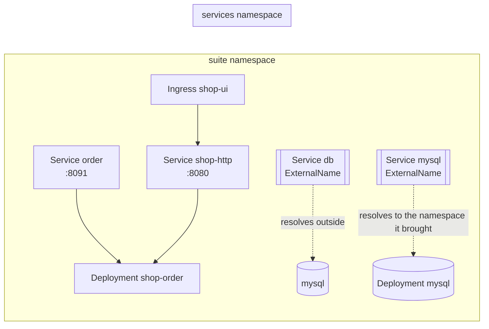

A Blong suite already knows what it is: which realms loaded, which layers registered, which
orchestrator namespaces were claimed. So we stopped writing that down a second time and made the
deployment read it.

```bash
cd suite/blong-suite && blong ./index.ts k8s
```

That writes the **repository half** of `system/kustomize/` — Deployments, Services, volumes, RBAC —
and exits; the declaration rides beside it as `example/`, because which suite a namespace runs is
the tenant's decision rather than the repository's. Nothing was configured to say which layer
belongs to which process, because the answer was already in the registry.

The other half belongs to the deployment. A second run over the same registry, given the values this
cluster owns — the namespaces, the artifact's identity, the credentials the deployment declares —
writes `local/` beside the base, and `kubectl apply -k system/kustomize/local` composes the two.
Only the base is committed: it is what a reader compares between two revisions, while the overlay is
what changes between two deploys.

<!-- truncate -->

## One code, many shapes

The framework's promise is that a suite runs as a monolith in development and as independent
services in production without changing a line. That promise needs a mechanism, and the mechanism is
now a profile:

| Profile     | Processes                      |
| ----------- | ------------------------------ |
| `monolith`  | one                            |
| `realm`     | one per realm (the default)    |
| `namespace` | one per orchestrator namespace |
| `group`     | the groups the config names    |

Same sources, different clustering. The interesting part is not that it works — it is that the plan
_derives_ the split, so adding an orchestrator to a realm extends the deployment without anyone
updating a map.

What a deployment brings along is the same kind of decision, and the switchboard spells it out:

| `services.<name>`     | What the deployment gets                                     |
| --------------------- | ------------------------------------------------------------ |
| absent                | nothing — the deployment has not asked for it                |
| `false`               | nothing; a name it still dials goes under `externalServices` |
| `true`                | generated, and refused if no activated adapter implies it    |
| `{image, storage, …}` | generated, with those values over the descriptor's own       |

That is what makes one set of sources portable between clusters: a bare one, one with a storage
class worth asking for, and one where the database is already somebody else's are the same suite
with a different answer here. The namespace those workloads run in is the deployment's too
(`servicesNamespace`, `blong-services` by default), as are the storage class and size their claims
ask for.

Credentials are the deployment's to declare rather than the tree's to invent. `credentials.secret`
names a Secret the deployment already owns, `credentials.values` gives the values to write, and
`credentials.generate` lets the descriptor derive them from the suite, the service and the version —
and a declaration with none of the three writes no Secret at all. Whichever copy the tree does write
is read as environment, `optional`, so a service that is switched off cannot keep a pod from
starting — and it carries a label, which is what lets a later pass take back exactly what it wrote
and never a Secret the deployment placed itself.

Changing the answer later is the same mechanism read the other way round: switching a service off
removes what the declaration generated — the alias, the credentials it wrote — while the workload,
its claim and its Service stay where they are, for whoever owns that namespace to retire. The
credential is the one exception, and deliberately so: it was derived from the declaration that
stopped asking for it.

## Namespaces are addresses

An orchestrator namespace becomes a Service with the same name. When one process calls another, it
names the namespace; the cluster resolves it. The same idea covers third-party systems: a suite
names `db`, and an `ExternalName` decides what `db` means in this cluster — and when the service is
one an adapter implies, the deployment _brings_ it: the workload lands in a namespace of its own and
the alias keeps the suite naming `mysql` rather than a host.



That last pair of arrows is the point: the suite never learns the address, whether the database was
already there or arrived with the deployment.

## The part that surprised us

A per-version volume sounded simple. It is not, because a `ReadWriteMany` volume shared across nodes
needs a storage class a bare cluster does not have — and an installer that only installs on clusters
with the right storage is not an installer.

So the default is a per-node cache: a DaemonSet unpacks the artifact into a version directory and
the deployments mount it read-only. No storage class, and the shared volume stays available where it
exists.

That DaemonSet then taught us something a dry run could not. Its only container fetched the
artifact, succeeded, exited 0 — and was restarted forever, because a DaemonSet restarts anything
that exits. `CrashLoopBackOff`, with no logs at all, which reads like a broken command rather than a
completed one. The fetch is an init container now. Applying the generated tree to a real two-node
cluster found it in a minute; every validation before that had been happy.

## The mirror that drifted

The operator has no kustomize binary, so it composes the base and the overlay itself. That is a
second implementation of someone else's semantics, and it drifted the first time it mattered: a
folder the overlay never named still reached the plan, because the mirror walked the directory while
kustomize reads what each kustomization names. A service switched off in the declaration came back
as five objects in a namespace nobody had stamped, and the pass failed in the cluster's `default`
instead of retiring it — a green run over a plan the operator had never seen. What we keep from it
is not _write the mirror more carefully_ but _check it against `kubectl kustomize`_: a step that
composes both and compares the objects catches what reading the code cannot.

## What we deliberately left out

The blong-kustomize realm has no database of its own. It therefore has no user table, so the
deployment UI's authentication is the cluster's — ingress annotations for basic auth or an oauth2
proxy — and the operator's identity is its ServiceAccount. A realm that needed a database in order
to deploy a framework would be the wrong shape, and the services a deployment brings are generated
as manifests rather than depended on: nothing here connects to anything.

The GitOps handoff is a seam, not an implementation: a handler that reports it pushed nothing is
more useful than one that pretends it did.

_Read the [concept](/docs/concepts/kustomize), the [pattern](/docs/patterns/kustomize) or the
[rationale](/docs/rationale/kustomize)._
