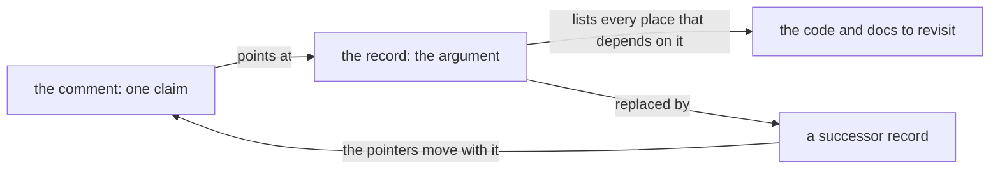

Every codebase has the same quiet failure mode. A paragraph of reasoning is written next to the code
it explains — why a retry creates a new job instead of re-applying the failed one, why a cache keys
on identity rather than on a version — and then the code moves. Six months later the paragraph is
either wrong, or deleted by somebody who read it as noise.

The writing is rarely the problem. The storage is. The argument was copied into the one place that
cannot maintain it, and a copy has no owner and no seat in any review.

Split the claim from the argument instead. The comment keeps the claim — the conclusion a reader
needs at that point in the code — and points at where the argument lives: a decision record, a
design note, an architecture decision record, an issue that is really kept. That is all a **prose
cross reference** is. An address, not a copy.

```text
// A retry creates a new job instead of deleting the failed one @@D-42
```

<!-- truncate -->

## Progressive disclosure, for prose

This is progressive disclosure applied to text that a person or an AI assistant meets mid-task. The
conclusion is right there, and the argument is one step away: a hover in the editor, a click, a
search that finds the record by its identifier instead of guessing at words. A reader who does not
need the argument is not slowed down by it, and a reader who does gets all of it rather than a
summary of a summary.

A codebase that copies its reasoning into every comment gives that reader no smaller thing to load.
Every file becomes expensive, the honest response is to read none of them, and the reasoning that
was expensive to acquire turns into the cheapest thing to lose. A pointer changes what the same
reader can do: act on the one line, and pull the full argument into context for the two files where
it actually decides something.

## A notation, not a sentence

"See the note on retries" is a pointer only in the sense that a reader can guess at it. A convention
needs a shape a tool can find without parsing English, and one shape that works is a marker that is
unlikely to occur in ordinary prose and unmistakable when searched for: a prefix, then the
identifier of the record. The example above is the whole notation — the claim, the marker (`@@` in
this repository), a letter saying what kind of record is being pointed at, and the number that
identifies it.

Three properties make that shape work. It is **findable**: one search lists every pointer in the
codebase, including the ones nobody remembered to mention in review, which is the only way a
convention can be audited at all. It is **resolvable**: the identifier names a record, so a tool can
follow it without knowing anything about the sentence around it, and the notation adapts to the file
it lives in — a token where a file cannot carry a link (source, configuration, scripts), an ordinary
link in a file that can. And it is **inert**: `@@D-42` does not read as a sentence, cannot be
confused with the prose it sits in, and survives re-wrapping, renaming and reformatting, which is
exactly what a cross reference written as a phrase does not.

The letter can say what kind of record is being pointed at, so the notation tells a reader what they
are about to open before they open it: a decision, a task, something that went wrong.

## Two rules, before any tooling

A pointer is only useful if two things hold.

**The reasoning has one home.** A record — a decision note, an ADR, a design page — that exists in
order to hold the argument, and that actually contains it. A pointer into a document that does not
carry the reasoning is a promise nobody keeps, and it is worse than no pointer at all, because it
looks answered.

**The pointer is checkable.** A stable identifier or an anchor that a tool can resolve without
understanding the prose around it. This is what decides whether the habit survives: a convention
that only a careful author can honour rots quietly, while a convention a machine can check is
enforced on every change.

## What a check can and cannot do

Almost everything a link checker can see, the same discipline can see in a comment: a record that
was deleted or renamed, a heading that moved, an identifier that two documents claim, a pointer left
pointing at something that was replaced.

| What rots                                 | Caught by                                          |
| ----------------------------------------- | -------------------------------------------------- |
| the record was deleted or moved           | the same check that finds a broken link            |
| the record was replaced by a better one   | it names its successor, so the pointers can follow |
| the pointer names a wrong but live record | nothing automatic — a person has to read it        |

The last row is the honest one, and it is where the tooling should stop pretending. A check proves
that an address exists, not that it is the address you wanted.

## Both directions, or it is half a map

Read forwards, a pointer takes a reader from the code to the argument. Read backwards, the same
index answers the question that actually costs money: not "what does this decision say", but "what
depends on this decision, and what did I just invalidate". A record that can list every place citing
it turns a design change from an archaeology project into a list of files to revisit.

That is also what keeps the three kinds of prose in step. A comment, a page of documentation and a
decision record are not three copies of one explanation; they are one explanation with three
entrances. When the record changes, the pointers can be found and moved, precisely because they were
never copies.



When a decision is superseded, the successor is named where the old record lives, and the pointers
follow it — in one pass, refusing any line whose text has moved since it was read. A pointer left
behind can fail the check instead of sitting in the tree as a plausible-looking address, so what
supersedes what stays in the repository instead of in somebody's recollection of a review thread.

## The approach was always right — the maintenance was the problem

None of this is a discovery. Keep the reasoning in one place, cite it from the code, keep the
citations alive: that advice is as old as technical writing, and it was never really disputed. It
decayed anyway. The work it needs is exactly the work that gets dropped first — after a refactor,
move a dozen pointers; when a note is superseded, find everyone who cited it; when a heading is
renamed, patch the anchor. Each of those is small, verifiable and tedious, and under deadline the
interesting part gets done while the bookkeeping waits for a quiet afternoon that does not arrive.

That is the part a coding agent changes. Handed a convention a machine can execute, the bookkeeping
becomes part of the change it was already making: tell it which record changed and which places cite
it, and it will move them in the same pass, because none of that requires judgement — only care. The
prose stops being the thing everybody agrees to keep and nobody does.

The agent gains from the same notation twice over. Maintaining pointers is mechanical work, and
reading them is a budget: a defined approach lets an assistant take the conclusion from the comment
and load the full argument only where it decides something, instead of paying for a wall of prose it
cannot afford or acting on a bare line it cannot justify. A convention stops being only how people
agree to write, and becomes an interface an agent can be held to — which is what a check in the
pipeline is for.

## What it cannot do

A pointer proves that the target exists. It cannot prove that the target is the one you wanted: a
wrong but perfectly live reference resolves cleanly, and only a reader notices. That boundary is
worth drawing clearly, because a team that automates the checking and skips the reading ends up with
prose that is consistently well-addressed and occasionally wrong. The tooling's job is to make the
audit cheap, not to replace it — a view that lists each pointer beside the title of what it found is
worth more than a score that guesses.

The rule that keeps it honest is one line long: point at the record that **holds** the reasoning. If
that record does not exist yet, write it, and move the paragraph into it rather than leaving the
argument in the comment with a pointer underneath.

## The point

Nothing about the idea is new. Footnotes, citations and references to architecture decisions are as
old as technical writing. What is new is that the pointers are cheap to check, so the habit survives
contact with a codebase that keeps moving — and that changes the character of the prose. It stops
being a snapshot that decays where it was written and becomes an index into reasoning that has one
home and one owner. The comment gets shorter, what a reader can reach gets larger, and the address
is one that a person and an agent can both follow.
