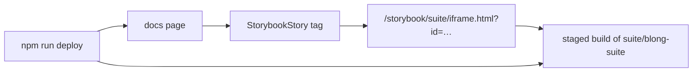

A page in these docs has always been able to _describe_ a screen. The Storybook next door could
always _show_ it. This week the two moved in together: the Storybooks are published with the
documentation, and a page embeds a story the way it embeds a picture.

```mdx
<StorybookStory
    site="browser"
    id="editor--toolbar"
    title="The Editor's toolbar"
/>
```

That is a real call, and this is its result:

<StorybookStory
    site="browser"
    id="editor--toolbar"
    title="Editor/Toolbar — the toolbar story, running in this page"
    height="520px"
/>

<!-- truncate -->

## A screenshot is a claim; a story is a component

Every picture in these docs was already taken from a story — the
[Editor feature guide](/docs/concepts/editor-features) photographs the very stories it describes,
which is why a section can say "see `Editor/Design`" and mean one command. What a picture cannot do
is answer a question. It shows the state the capture driver arranged, and nothing about what happens
when a reader presses the button that state is about.

An embedded story answers it, because it is not a rendering of the component: it is the component,
with its fixture data and its platform, in a frame on the page. The picture still matters — it is
what a reader sees before deciding whether to wait for a Storybook to boot, and it is what a build
with no Storybook staged shows instead. So an embed takes a `poster` and becomes live on a click,
and a page that leaves the poster out opens the story immediately.

## Three decisions, and the reasoning behind each

**The Storybooks are published beside the pages, not beside the stories.** Each site is built by its
own package and staged into the docs site's own tree, so it is served from the same origin as the
page that embeds it — under `/storybook/<name>/` — and published by the same `npm run deploy`. Same
origin is not a detail: a cross-site frame is a policy question, a second certificate and a second
deploy to forget, and a doc deploy that publishes the pages while the storybook stays behind is a
page full of empty frames nobody sees until a reader reports it.



**The staged trees are not committed.** A Storybook build is 10 to 30 MB, and the docs package
installs its own `node_modules` with npm precisely so that no monorepo build stands between a docs
change and a `docusaurus build`. Staging is therefore a step of the _deploy_, not of the build: CI
builds the pages without it, every embed renders its poster, and the verification run counts the
embeds that rendered rather than the stories they would have loaded.

**Publishing checks the embeds it is about to publish.** A story id is a name in a URL, and a name
is exactly the thing that rots when somebody renames a story. So staging resolves every
`<StorybookStory>` in the docs and the blog against the `index.json` the build itself wrote, and the
verification run then loads each embedded story in a browser and waits for the story to render. Both
failures it catches are invisible otherwise: an id nobody serves yet, and a preview that cannot boot
standalone. The second one is the more interesting of the two — a story only ever opened from a
Storybook dev server can depend on something the dev server provides, and a static build is where
that dependency shows up.

## What a page can now ask for

A story opened at `theme:wood` is the wood skin of the same editor, `language:bg` renders its
toolbar in Bulgarian and `direction:rtl` mirrors the layout — the same globals a Storybook URL
takes, so a page about a variant embeds the variant instead of describing where to click to see it:

<StorybookStory
    site="browser"
    id="editor--wood"
    title="The wood variant of the same story, one globals attribute away"
    height="560px"
/>

The theme page uses exactly that to put the glass and wood halves of a pair side by side, and the
i18n page embeds its story in Bulgarian. The `chrome` attribute is for the pages that document the
story toolbar itself: the toolbar is Storybook's own UI, outside the story canvas, so the only way
to show it is to embed the manager rather than the frame.

## What was not built

The published Storybooks run on **fixtures**. The toolbar's live-backend modes are a dev-server
plugin, and a static build has no dev server — so an embedded story shows the fixture-backed page,
which is the right thing for documentation and not a substitute for the toolbar. Reviewing a story
against a real gateway stays a local act.

There is also no hosted Storybook service in the middle: no build per pull request, no visual diff,
no account. Chromatic already covers the visual-baseline half of that in CI, and the embedded story
covers the half a reader needs — the page they are reading and the component they are reading about,
served from one origin, deployed together.

One sharp edge worth recording: `docusaurus serve` redirects `iframe.html?id=…` to a query-less
`iframe`, so an embed cannot be checked with `npm run serve`. `npm start` serves it, the published
site serves it, and `blong-dev docs verify` both serves and checks it.

## Where to use one

The [Storybook pattern](/docs/patterns/blong-browser#embedding-a-story) is the how-to, with the
attribute table and the two sites' names; the
[Editor feature guide](/docs/concepts/editor-features), the
[model system](/docs/concepts/blong-model), the [theme pattern](/docs/patterns/theme) and the
[i18n pattern](/docs/patterns/i18n) are the worked examples. Adding one to a page you are already
writing is one line — and if the story you want is not in a published site yet,
`storybook-sites.json` is where a site is added.
