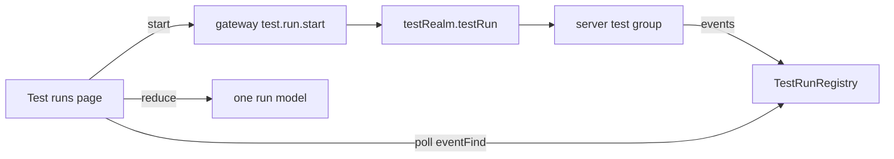

A failing test gives you a stack trace and a line number. It does not give you the twelve steps that
ran before it, the value two of them passed along, or the branch that was taken three calls earlier.
So the first debugging session is usually a re-run with print statements — the same information,
paid for twice.

Blong's Test runs console starts the run from inside the portal and shows it while it happens. The
steps are a timeline, the dependencies are a graph, and every assertion sits beside the value the
step returned. The console is a page in the application, not a separate report.

<!-- truncate -->

The `Replay` story below is a recorded session flow playing at 1x. Pause it, speed it up, or restart
it; the same model drives the page and the replay.

<StorybookStory site="browser" id="components-testrun--replay" title="Components/TestRun — Replay"
height="560px" poster={require('./img/test-run-replay.png').default} />

## The report is a post-mortem; the run is the evidence

The console is built on a **JSON-safe run model**: steps, dependency edges, assertion counts,
progress points and branches. It has no `Map`, no `Set`, no `Error` instance and no `Date` — every
time is epoch milliseconds. That is what lets the browser source, the server source, the recorded
fixture and the Storybook replay all use one reducer.

The layout is the same model read in three ways:

- the **tree-table** keeps the group order and draws each step as a bar on one shared time scale;
- the **graph** draws the dependency edges — the step that produced a value and the step that read
  it;
- the **details** panel opens the step's result, its progress points, its source pointer and the
  assertion messages in execution order.

A failure is not a red row at the end. It is a step whose bar stopped early, with the assertion log
that explains why and the dependency edge that says what it was waiting for.

## A catalog is the guard

The page does not accept an arbitrary method name. A realm declares a catalog of scenarios, and the
page can only load those. Each entry names where its steps run:

| Host      | Where the steps execute                                          |
| --------- | ---------------------------------------------------------------- |
| `browser` | in the page's own window, against the live application           |
| `server`  | in the process that owns the server handlers, polled by the page |

The server side has its own allowlist (`testRealm.testRun.serverGroups`), so the catalog is the
visible set and the allowlist is the executable set. Both are small and reviewable; neither turns
the page into a remote code runner.

## One console, two hosts

Some test groups call handlers that only exist on the server: login, session storage, an audit
trail. Running those steps in the browser would test a different system. For a server entry the page
calls the `test.run.*` methods through the backend adapter, reads the event page from a cursor and
reduces it with the same reducer.

A browser entry is shorter — the executor runs in the page and emits the same events — which is why
the console does not need a second UI for the two cases. The server transport is four methods:
`start`, `eventFind`, `snapshotGet` and `cancel`. Leaving the page cancels the run; nothing keeps
working after the reader is gone.

## What the reader gets

The first version of the console was a Storybook fixture. It made the shape reviewable before a
gateway existed: the tree, the bars, the graph and the details could be judged against a real
recording rather than an invented one. The `Replay` story is still the cheapest way to see the
component, and it is the frame above.

The second version ran the same groups from the portal. What changed is not the picture but the
question it answers. Instead of “what does a run look like”, the page answers “what is this run
doing right now” — and it answers it with the same model the report and the fixture use.

[The concept](/docs/concepts/test-run) describes the page; [the pattern](/docs/patterns/test-run)
has the catalog, transport and server configuration; [the rationale](/docs/rationale/test-run)
explains why the console is part of the application rather than a report.
