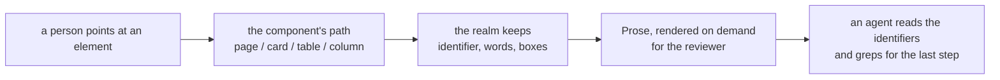

The cheapest bug report a person can write is a sentence and a circle. What arrives instead is a
screenshot and "the header is cut off on narrow screens" — and then whoever fixes it searches the
codebase for a table that might be the table in the picture. If they pick the wrong one, the report
comes back.

The picture and the sentence are fine. What is missing is _which_ element, said in a way a program
can act on. Pixels cannot say it, a CSS selector rots as soon as the layout changes, and an array
index is not an identity.

Blong's **feedback mode** lets a person point at the element in the running application, and records
the element as the path the application itself uses: the page, then one step per container.

<!-- truncate -->

## What the person does

They press `F2`. One capture-phase guard takes over the document, so the click they make next cannot
close a menu, page a table or submit a form — it only says which element they mean. A callout
appears beside it with its own arrow, and they type a sentence. The box can then be dragged and
resized, because a comment box that lands on top of the thing it describes is a small insult the
person should not have to accept.

Before submitting they can crop the picture to the part that matters. A full screen carries a
toolbar, a menubar and half a sidebar that tell a reader nothing.

<StorybookStory site="sport" id="sport-feedback--athlete-browse-feedback" title="Two comments in
their callouts, each joined to its element by an arrow" height="620px"
poster={require('./img/feedback-callouts.png').default} />

Each outline is labelled with the **tail** of its identifier — `legalName`, `clubShortName.label` —
because the full path is forty characters of context the person does not need. It is one hover away.
The frame above is the live story: click any header or field and write another comment yourself.

## What is stored

Not a document. A session, one row per comment, and the picture:

- the **identifier**, e.g. `sport.club.browse/card:browse/field:club/table:club/column:legalName` —
  the page, then `kind:name` steps, never an index;
- the words, the target's kind and its label;
- the **anchor** and the **callout**, each as a fraction of the cropped picture, so the reviewer
  sees both boxes where the person left them at any screen size;
- the page URL, who submitted it, the language, and whether the capture succeeded.

The Markdown is rendered from those rows whenever it is asked for and never saved. Correcting a
wording changes the next render, and there is no second copy of the truth to go stale.

## The path is the point

A selector describes the DOM; the path describes the application. Components publish it as they
render — the model entry names the page, the card names itself by its `cardName`, the table by its
field, the column by its field, and a label is an unnamed step whose text travels as the target's
label. So the same click reads as the same thing whether the table is sorted, paged or re-laid out,
and the tail is what a person would call the element anyway.



## What the reviewer does

The review page opens the queue and draws the picture with every recorded anchor and callout on it —
the boxes are where the person left them, and they are the editor. A reviewer rewrites the words in
the box, drags it off the thing it hides, resizes it, or closes a comment that is noise, and each of
those acts is a row update. Then two more: render the document for the selection, and mark that
selection processed. The frame below is that page live.

<StorybookStory site="feedback" id="feedback-review--open" title="The review page: the picture with
both boxes, the comments beside it, and the document" height="720px"
poster={require('./img/feedback-review.png').default} />

What an agent receives is a document that names its own format, quotes each comment, and ends with
the identifiers in one block:

```text
<!-- blong-feedback v1 -->
# Feedback — 1 submission, 2 items

## sport.club.browse (Clubs) — 2 items

- Session: `cffb9037-b815-426d-8331-2091ec995b4a`
- Submitted: 2026-10-29 13:55
- Screenshot: captured
- Page: `/s/club`
- Language: en

### 1. `sport.club.browse/card:browse/field:club/table:club/column:clubShortName/label` — label "Short Name"

> The label does not say which club this filter is for.

### 2. `sport.club.browse/card:browse/field:club/table:club/column:legalName` — column "Legal Name"

> The header wraps and cuts the text.
```

The last section of that document lists the identifiers again in one block, so an agent can search
the codebase for the tail of each path without parsing the comments above it.

Two tables, seven handlers and one page: the storage half is deliberately boring. What took the
thought was everything else — the guard that stops a click from doing its usual job, the geometry
that keeps a box beside its element and a line between two borders, the capture that has to survive
a refused picker, and the discipline of paying nothing when the mode is off.

That last one is worth stating plainly: a suite that never turns the mode on renders exactly the
tree it rendered before. The activity flag is a context published once, every hook answers nothing
while it is off, and a call site writes `{...target}` or `target?.('button', …)` rather than
building attributes and translations for something nobody is annotating.

The concept — the identifier grammar, the freezes, what a screenshot can and cannot be — is in
[the feedback concept](/docs/concepts/feedback). The configuration block, the RBAC grants, the
storage and how to make a component addressable are in the
[feedback pattern](/docs/patterns/feedback).
