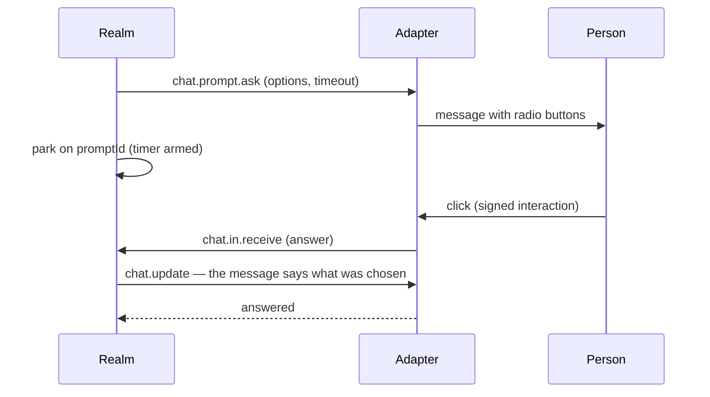

A chat bot is the smallest integration that is not small. The platform calls you, you call it back,
a person has to answer a question inside the conversation, and the credential that makes any of it
work expires while the process is idle. Slack and Viber disagree about almost every detail of that
and agree on nothing about the words they use for it.

The `blong-chat` realm is the proof that one adapter can carry all of it: one URL for both halves of
the conversation, one method the realm answers, and a process that maintains its own Slack app from
a database rather than from a config file a person edits by hand.

<!-- truncate -->

## The adapter is a shape, not a platform

The framework's `adapter.webhook` knows three things: how to check that a delivery really came from
the platform, how to map a payload into one canonical inbound, and what to answer so the platform
does not retry. Slack's Events API and its Interactivity API post to the _same_ URL — one is an
`event_callback`, the other a `payload` form field — so an adapter that treated a path as a protocol
would need two paths and two registrations for one app.

What the realm declares is the address and the account lookup:

```ts
k8sPorts: {chatSlack: {port: 8095}},
k8sIngresses: {chatSlack: {path: '/chat/slack', servicePort: 8095}},
```

and the path itself carries the two ids a request names, which is how one process serves several
bots without a lookup table in front of it:

```text
/chat/slack/{appId}/{clientId}/{action?}
```

Everything after that is a mapping. A `block_actions` payload becomes an answer, a `view_submission`
becomes an answer with a text field, a `message` becomes a message, and the realm never learns which
of Slack's twenty payload types it was. Viber's adapter produces the same four shapes from its own
vocabulary, and the realm's dispatch does not change.

## The question that returns an answer

The part with no precedent is the ask. A realm that wants to ask a person something cannot hold an
HTTP request open, and cannot poll a UI that does not exist. So `chat.prompt.ask` posts the
controls, parks the call on a promise keyed by the prompt id it minted, and returns when the answer
arrives:



Three details are what make it usable rather than a demo. The ask **times out**, because a promise
nobody resolves holds a request for the life of the process. The message is **rewritten** once it is
answered: the options stay, the chosen one is marked, and the controls go, because a control that no
longer answers anything is a trap. And the message is **closed** when the question expires — the
options stay, a line says nobody answered, and the live buttons go with the pending entry, so a late
click is not a button that does nothing.

A typed reply still answers. A free-text answer carries no prompt id — there is no button to carry
one — so a pending question _claims the next message in that conversation_, and only while something
is pending. A click that arrives after the timeout is not an error either: it is a real condition,
the platform has already been answered, and the realm forwards it to whatever consumer the account
is configured with, because a session may still be open somewhere else.

## The credential nobody wants to think about

A Slack app configuration token authorizes app management in a **workspace**, not for one bot. That
one sentence changed the schema: the token pair lives on `chat_workspace`, once, and an account only
names the workspace it belongs to. Two bots in one workspace share the pair, and a rotation replaces
it in one place.

Slack answers a rotation with a new pair and spends the old refresh token, so the write-back is not
a nicety — a process that renews and does not store the replacement works until its next restart and
then fails with a token that no longer exists. The pass therefore refuses to renew when it has
nowhere to store the result, and says so, rather than renewing and hoping.

The same pass maintains the app:

1. read the accounts — from the database when it holds any, otherwise from the config;
2. renew each workspace's pair once, when it is close to expiring;
3. for an account with no app id, create the app from a bare manifest and store what Slack answered;
4. point the app's request URLs at the address the process answers on, after checking that the
   address actually answers.

Step four is the one a first deployment teaches. The manifest update is tightly rate-limited, so the
manifest is read first and left alone when it already names that address. And the address has to
_answer_: an Ingress that names a TLS secret nothing issues accepts no handshake at all, and the
adapter's warning — "the public address does not answer yet" — is the honest report of a certificate
that was never asked for.

## What a deployment had to be told

The realm is deployed like any other suite, and two addresses fell out of the shapes above rather
than out of a preference. The portal owns its host, and a webhook sharing that host would inherit
the portal's authentication — ingress annotations belong to the host, not to a path — so the webhook
answers on its own host. That host is the suite's to name, and so is the issuer that signs its
certificate; a contributed ingress may now carry the host's annotations for exactly that reason.

The other lesson was blunter. A cycle that ships the artifact and reuses the framework image ships
no change to `core/blong-gogo`, where the adapters live: the same config, the same database and the
same intent list passed locally and did nothing in the cluster, and nothing in the runbook said so.
The adapter now logs one line per pass naming the store and the accounts it resolved, which turns
the difference into something a reader can see.
