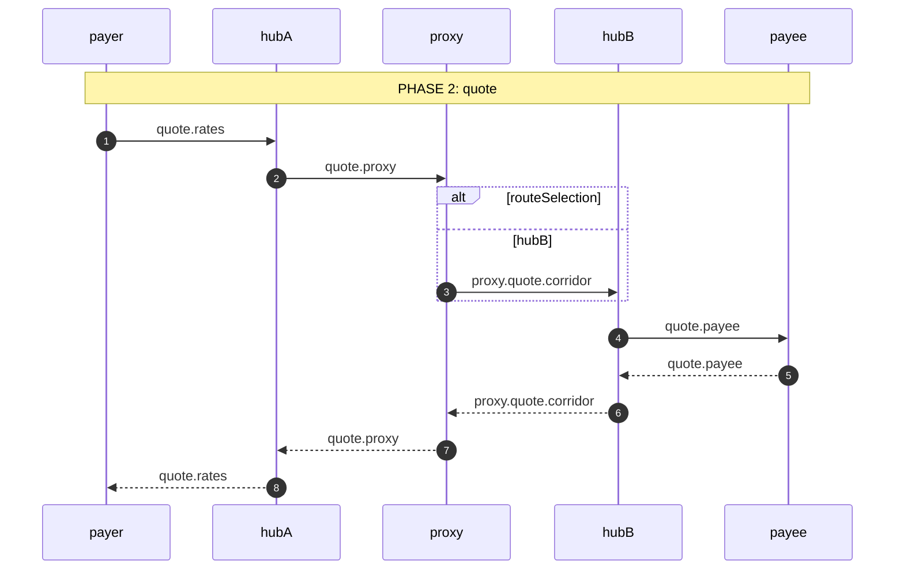

Every logging library in the last twenty years lets the call site write the sentence. That one
decision — the message is composed where the event happens — has quietly cost us three things:
identity that moves when nobody changed behaviour, alerting that breaks on a reworded line, and
configuration that can only ever speak in levels for a whole service.

`lukaot` moves the sentence to a declaration beside the code, and the call site names it. The result
is one vocabulary with **four kinds** — a line, an error, a payload, a decision — and an identity
that exists before the process starts.

<!-- truncate -->

## The three steps

| Generation            | What it added                                                               | What stayed broken                                                         |
| --------------------- | --------------------------------------------------------------------------- | -------------------------------------------------------------------------- |
| `printf`-style output | a sentence                                                                  | nothing can read it                                                        |
| structured logging    | fields, levels, machine-readable records                                    | the call site still writes the sentence; a level is a service-wide dial    |
| `semantic-log` (ours) | identity derived from structure: mask, hash, one **template** per code path | identity still derived from **text**, so a reworded message is a new event |
| **lukaot**            | identity **declared** in a file beside the code                             | — the name is the identity                                                 |

The third step was a real improvement: two occurrences of one code path finally shared one identity
however their values differed, and that identity survived a redeploy of unchanged code. But the
identity was still a hash of words somebody typed at the call site, so "we reworded a message" and
"we added an event" looked the same from the outside.

The fourth step removes the derivation: if the name is written once, two occurrences agree because
they call the same function. Nothing has to be masked or hashed to make them agree.

## One mechanism, four kinds

```ts
export default declare({
    log: {
        fxpRateDeclined: {level: 'warn', message: 'rate declined: {rate} above {rateLimit}'},
    },
    error: {
        agentTicketNotFound: {message: 'ticket {ticketId} is not in the pool', statusCode: 404},
    },
    decision: {
        rateWithinLimit: {
            message: 'whether a provider quotes the rate it was asked for',
            branch: {decline: 'above this provider limit', accept: 'the rate is quotable'},
        },
    },
});
```

| Kind         | Before                                           | Now                                                         |
| ------------ | ------------------------------------------------ | ----------------------------------------------------------- |
| **log**      | a warn call with a template-literal message      | `signal?.fxpRateDeclined?.({rate, rateLimit})`              |
| **error**    | `throw new Error('ticket not found')`            | `throw errors.agentTicketNotFound({ticketId}, $meta)`       |
| **capture**  | `log.debug({headers, body}, 'http exchange')`    | `capture?.http?.({method, phase}, () => exchange)`          |
| **decision** | `if (rate > limit) { … }` — invisible afterwards | `decide(vocabulary.decision.rateWithinLimit, values, arms)` |

Three properties follow from the declaration and none of them is available to a level API:

- **One name, changed without the code.** A realm configures `level`, `enabled` or `sample` per
  identifier — `agentAnswerWakeUnpublished: {enabled: false}` — and the call site is untouched. An
  unknown key is warned about rather than silently ignored.
- **A closed set of arms.** A decision's arms are declared, so an arm the declaration does not offer
  is a compile error at the call site — and a decision never depends on its own recording: switched
  off, it still decides and only the record stops.
- **Evidence instead of absence.** The branch records the discriminator, every arm in evaluation
  order, and the one taken, which is what lets a sequence diagram draw an `alt` block around the
  calls the arm made.

## The diagram is the proof

The two flows in `core/lukaot/flow/` run over real HTTP, each participant declaring its own
vocabulary; a test runs both, renders the diagrams from what the service observed, and compares them
with the committed artifact. Every arrow label is a name that can be grepped in the file that
declares it:



`routeSelection` is a declared decision, `proxy.quote.corridor` is a leg id the source declares, and
the `alt` arm names the ecosystem the proxy chose. Nothing in that block was typed by hand.

## Where to read more

- [What lukaot is](/docs/concepts/lukaot) — one page, four kinds
- [How to declare and call it](/docs/patterns/lukaot) — the reference, kind by kind
- [The flows a run observes](/docs/patterns/lukaot-flows) — the diagrams, annotated leg by leg
- [Why the identity is declared](/docs/rationale/lukaot) — the trade-offs, and what this replaced
