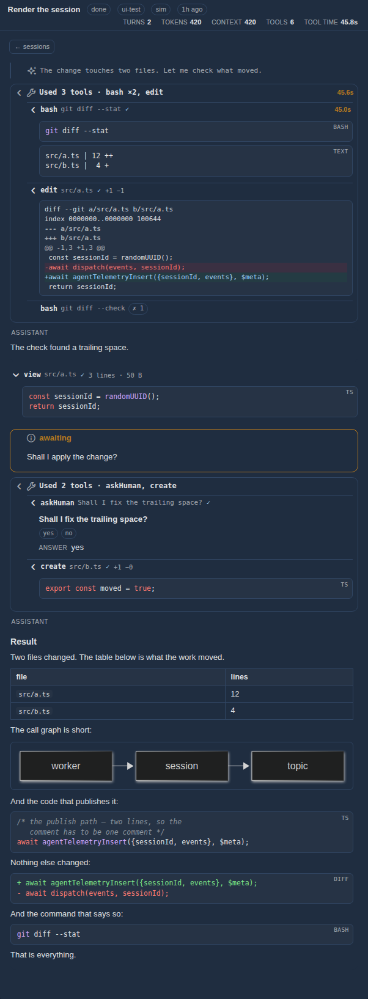

The agent realm was built to do one thing that could not be proved any other way: hand a coding
agent a ticket in this repository, let a model work it on a machine of its own, and watch the work
happen from a browser on another machine. It ran — a runtime on a box in the next room claimed a
ticket, wrote files in a jailed workspace, asked a person a question, resumed with the answer, and
the page drew each step while it was still happening.

What is interesting is not that an agent can edit code. It is that a session became something you
can **read after the fact, watch while it runs, and assert on in a test** — three properties that
pull in different directions and that one design ends up serving.

<!-- truncate -->

<ArchifyDiagram slug="agents-workflow" title="One ticket, one runtime, one transcript"
height="760px"
posterLight={require('../../docs/rationale/img/diagrams/agents-workflow-light.png').default}
posterDark={require('../../docs/rationale/img/diagrams/agents-workflow-dark.png').default} />

## Three machines, three kinds of trust

The picture has a browser, a realm, and a runtime host with a model behind it. Each one is trusted
with something different, and the boundaries are where the interesting decisions are.

The **runtime host** owns the loop. A copilot runtime on a LAN address runs its own shell, file and
edit tools against the directory a ticket may touch, and reaches the model over an OpenAI-compatible
wire with a key the account carries. The realm does not drive that loop, which is what makes the
runtime swappable: a scripted account takes the same seat in a test as a real one.

The **realm** owns the tools the runtime cannot answer. Asking a person, and saying the session is
finished, are the realm's; they reach the model as custom tools that dispatch back into
`agent.tool.run`. That is why "shell access is off in this deployment" is a true statement rather
than a prompt: a session offered no shell tool cannot run a command, whatever the model decides to
try.

The **page** owns nothing. It reads a route and draws what arrives. A session that started an hour
ago replays from the topic, a session that is running streams into the same reducer, and the two are
indistinguishable by the time the transcript appears.

## The feed is the product

The decision that shaped everything else: every turn is published before anybody reads it.

That buys the replay. A transcript is not a client's memory of a conversation; it is a record the
system keeps, and a page attaches to it at a cursor — `partition:offset` — so a reconnect continues
without a gap or a repeat. The topic is keyed by session id, so one session's events share a
partition and keep their order, and the first batch of a session waits for its delivery report,
because that report is the only place a partition becomes a fact.

It also forces the harder property: a running session has to be readable while it runs. The route
that serves it is a **stream**, not a poll — the handler answers an async iterable and every frame
leaves as one frame, sealed with the caller's key, because a transcript is exactly the thing the
connection exists to protect. A keepalive frame, an SSE comment in the text envelope and a flagged
frame in the binary one, keeps an idle proxy from closing a connection the reader still wants and
lets the reader tell a quiet session from a dead one. A frame carries at most one mebibyte, and the
writer refuses to emit one that a reader would reject. And `Accept` picks the envelope:
`text/event-stream` for the one a person can read with `curl`, `application/vnd.blong.stream` for
the one that costs no base64.

## A question is a suspension, and a suspension is a checkpoint

The beat that made the whole thing real was the cheapest one to overlook: a person, asked a
question, answering it.

The first live run told the model its question had been answered with `{"ok": true}`. Everything
looked right — the checkpoint held the question, the answer had arrived 84 milliseconds later — and
three readings of the code found nothing. The cause was one line's assumption: a local dispatch
answers with the framework's pair, `[payload, meta]`, and the engine read `result` off the pair and
fell back to its own acknowledgement. Three lines of logging settled in one run what an afternoon of
reading had not. A question that parks a run now writes the prompt, the tool call and the history
into a checkpoint before it waits, the answer arrives as a row, a wake publishes on a channel the
orchestrator listens to, and the resume names the same runtime session and the same pending call.

## The page reads what the model did, not what it said

The last surprise was the payloads. Two engine kinds report the same work in different shapes: one
streams deltas, the other hands over whole messages; one puts an exit code in `shellExecution`, the
other at the top level. A page that printed the payload drew a wall of JSON — `sleep 15` rendered
with a `{"content": "\n", "detailedContent": …}` envelope under it, and a `view` call sized by a
diff-shaped snapshot that was never a change.

So a tool call is now read into what it did — command, exit code, output, path, content, diff,
question, options, answer — and each kind gets the card it deserves. A shell is its command and its
output with a bare tick when it worked; a write is its content with the lines it added; an edit is
the coloured diff; a read is the file; a question is the card with its choices and the answer a
person gave. A run of calls with nothing between them is one row, and the marks that carry no
information — a pill on every success, a duration on every call, a caret on every head — are gone.

## What it took to trust it

The test that closes the loop is a scripted task: seven steps, each preceded by `sleep 15`, so a
person has time to watch. It asks the agent to write a note with a table, a script that computes, a
mermaid flow, a question for a human, an edit to a file it already wrote, and a closing message a
chat page can render. Two runs, two accounts, both through Kafka — the partition a broker assigned
is on the session row, which is how the run proves it went through a broker rather than a ring in
the process.

The loop that produced those runs had three agents in it, and only two of them were the runtimes:

<ArchifyDiagram slug="agents-test-loop" title="Three agents, one script, one page" height="820px"
posterLight={require('../../docs/rationale/img/diagrams/agents-test-loop-light.png').default}
posterDark={require('../../docs/rationale/img/diagrams/agents-test-loop-dark.png').default} />

What the picture at the end is not: a claim. It is the session itself, with the exit codes, the
diff, the question, the answer and the token count the model cost.

The design reasoning is in [agents developing agents](/docs/rationale/agents-developing-agents), and
the contract a page reads is in [watching an agent session](/docs/patterns/agent-session).
