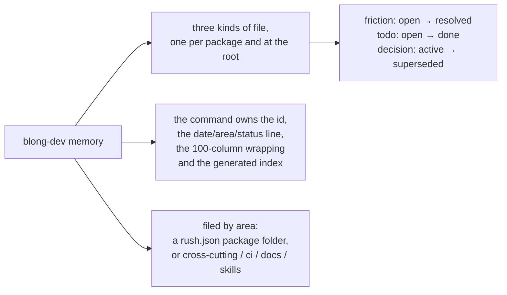

# Memory files

The repository keeps three kinds of working note — **frictions**, **todos** and **decisions** — as
markdown files under `.github/memory/`, one file per kind at the repository root and one per
package:

| Kind     | File          | Statuses               | Holds                                                                     |
| -------- | ------------- | ---------------------- | ------------------------------------------------------------------------- |
| Friction | `friction.md` | `open`, `resolved`     | something that took unexpected effort, and the lesson that came out of it |
| Todo     | `todo.md`     | `open`, `done`         | work that is deferred, unfinished or spotted and not done                 |
| Decision | `decision.md` | `active`, `superseded` | a choice that was made, with the reasoning the code does not show         |

Everything goes through `blong-dev memory` — the files are never written by hand, because the same
command owns the ids, the date/area/status line, the 100-column wrapping and the generated index.
Each entry has a stable id (`F-014`, `T-003`, `D-081`), so a note can cite another one without a
line number that rots.

Each entry is also pushed into a local **semantic index** as it is written, so the notes can be
searched by meaning rather than by the words an entry happens to use. That index is derived and
disposable: the markdown stays the source of truth, an unreachable server never fails a write, and
`blong-dev memory index --semantic` rebuilds the whole thing. The same bank also holds the published
documentation pages and the agent skills, each keyed by its path so an edit replaces rather than
duplicates — a search asks for the entries unless it names another stream.

Entries are filed by **area**: a package folder from `rush.json` (`core/blong-browser`) or one of
the reserved cross-cutting labels `cross-cutting`, `ci`, `docs`, `skills`. A package's entries live
in that package's own file; the root file keeps only what concerns the workspace as a whole.

- [Pattern guide](../patterns/memory) — the commands, the entry shape, the checks, semantic search.
- [Rationale](../rationale/memory) — why the notes are files with ids instead of prose and a
  tracker, and why the index over them is disposable.

## Cross-references

A note is pointed at from outside with a **reference**: `@@` immediately followed by a target.

| Target        | Token                                        | Names                              |
| ------------- | -------------------------------------------- | ---------------------------------- |
| memory entry  | `@@F-014`                                    | the entry, wherever its file lives |
| doc page      | `@@doc:patterns/memory`                      | a page under `docs/blong/docs/`    |
| doc section   | `@@doc:patterns/memory#searching-by-meaning` | the heading with that slug         |
| skill         | `@@skill:blong-realm`                        | `.github/skills/*/SKILL.md`        |
| skill section | `@@skill:blong-realm#layers`                 | the heading with that slug         |

`@@` cannot appear in TypeScript, YAML, shell or markdown syntax, so the token needs no escaping and
is greppable as text (`grep -rF '@@T-'`). In a markdown file — a doc page, a skill, a memory entry —
a page or a skill is named with a **normal relative link** instead; only a file with no link syntax
uses the `@@doc:`/`@@skill:` spelling. A reference that no longer resolves fails
`blong-dev memory refs --dangling`: an unknown id or a missing section is an error, a retired id is
a warning that names its successor, and a syntax _example_ inside backticks or a fence is ignored.

A closed or pruned id is not forgotten: it is recorded in `## Retired`
(`- F-101 — superseded by F-090 (2026-08-01)`) and its number is never reused, so a reference that
outlived its entry is diagnosed instead of silently pointing at a later one. See the
[pattern guide](../patterns/memory) for the commands.
