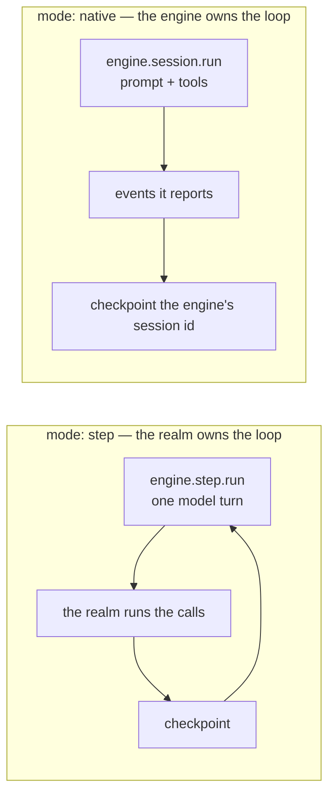
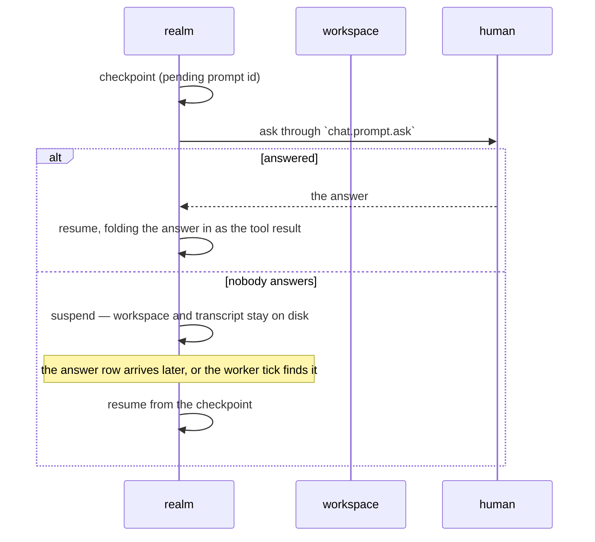

# The agent engine

An _agent_ is a process that works a task in a workspace and talks to a person when it cannot decide
on its own. This page is about the two pieces that make that possible without the realm owning a
vendor SDK: a session that names its **engine mode**, and a **checkpoint** that survives a question.

For the realm that implements it, see `realm/blong-agent` and its README.

## Two modes, one contract

The engines do not agree about who owns the tool loop, so a session names the answer:

The contract is `core/blong/src/agent.ts`: a neutral transcript (`IAgentMessage`), the tools a model
may call (`IAgentToolDefinition`), and the two request/response pairs. Nothing in it names a vendor,
which is what lets one realm run a Mastra account beside a DeepSeek Harness one and resume either on
the other.

An account is a key in an instance's `accounts` map, so the same model configured twice is two
accounts rather than two fields. The mode belongs to the account — a claim asks the engine adapter
which mode an account answers with, and records that on the session.

## The interruption

A question is a **tool call** like any other, and the session has to survive the wait:

Three rules make that work, and each is a bug if it is skipped:

1. **The pending checkpoint is written before the ask**, not after. A process that dies mid-question
  must leave the prompt id behind, or the answer has nothing to attach to.
2. **The checkpoint is written after the tool results**, never before. A resume replays the
  transcript, so a checkpoint that is missing a result re-runs the call it does not have.
3. **The answer is a row, not a promise.** A promise cannot be awaited by the next process, so the
  answer is stored (idempotent on the prompt id) and the resume reads it — that is what a wake-up
  broker, a worker tick and a second host can all act on.

## The workspace

A ticket gets one directory, under a root the deployment owns. Three boundaries, all in the adapter:

- **The jail.** Every path a handler accepts is resolved inside the ticket's directory; an absolute
  path and a `..` are refused rather than normalised, because a symlink can make either of them true
  later.
- **Commands are argv, never a shell.** The command and its arguments are a list, the environment is
  an allow-list, and the output is capped.
- **The timeout kills the process group.** A command that outlives its bound is killed with its
  children, or a ticket's workspace keeps a process nobody can see.

The capability boundary for commands is the container, not an allow-list: a deployment that enables
`runCommand` mounts only the workspace volume into that pod.

## Where a ticket comes from

The pool is an adapter, not a table in this realm: it answers `task.next.claim`,
`task.ticket.release` and `task.ticket.edit`, and a claim carries a lease, so two workers polling at
once take one ticket between them. A `blong-task` realm answers the same three methods, and swapping
the fixture for it is one file.

## What carries the work, and what only wakes a host

- **The worker tick** is the mechanism: the inbox first (answers nobody acted on), then a claim. An
  interval with an in-flight guard, `unref`'d so it never keeps a process alive on its own.
- **A broker is a nudge.** Publishing a wake on Redis or Kafka shortens the wait for a suspended
  session. It cannot carry the work: a wake that is lost, duplicated, or delivered to the wrong pod
  must change nothing, which is why the answer row is the truth and a wake only decides when a host
  looks at it.
- **The group id matters.** A wake must reach every pod, so a consumer group per host (`HOSTNAME`)
  is the rule; a shared group would give the wake to one pod and the pod that owns the workspace
  would never hear it.

## One account, any endpoint

`kind` and the model are two different decisions, and separating them is what keeps a deployment's
vendor out of its code: **`kind`** says who drives the loop (`sim`, `vercel`, `mastra`, `deepseek`),
**`provider`** says what shape the model answers in. The default provider is the OpenAI
chat-completions shape, which is what most services publish as their compatible endpoint — OpenAI,
Azure, Ollama, vLLM, LM Studio, OpenRouter, Groq, Together, Mistral, DeepSeek, xAI, Gemini's
compatibility base and Anthropic's — so reaching a new host is a base URL, a key and a model name.
`anthropic` and `gateway` are the native ones, both installed beside `ai`; an image that prunes one
fails the account that names it alone rather than taking the process down with it, the rule the
engine kinds already follow.

The call settings are the SDK's own vocabulary: `temperature`, `maxOutputTokens`, `topP`, `seed`,
`stopSequences`, `providerOptions` and `reasoning`. `reasoningEffort` is a shortcut for the last of
them, which the SDK translates per provider rather than one vendor's flag the others ignore; a
`parameters` bag is merged last for everything the typed fields do not cover.

## See also

- [Handler](./handler.md) — the `super` chain, injected handlers, the `db/<method>` qualification.
- [Orchestrator](./orchestrator.md) — a dispatch namespace and what it forwards.
- [Adapter](./adapter.md) — where a vendor SDK belongs.
