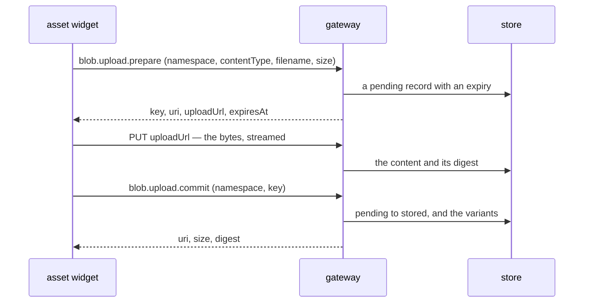

# Blob Store

## Overview

A realm that stores files attaches `@feasibleone/blong-blob` as a **companion**: every process that
carries it can store and serve its own content, and the realm owns no process and publishes no
Service. What a record holds is a reference (`blob://<namespace>/<key>`), never the bytes — see the
[blob concept](../concepts/blob.md) for why.

## When to use it

Use it when a record carries content rather than text: a photograph on a person, a signed PDF filed
against a document, an exported workbook. Use it _instead of_ a `base64` column, a byte array, or a
path on a shared volume — the first two bloat every row and every response, and the third is a file
nobody can authorize.

It is not a document manager. Filing, naming and versioning content is the owning realm's business.

## The three-phase upload

Three calls, never one, because each buys something the others cannot.



- **The limits are checked before a byte moves.** An unknown extension, a media type that does not
  match its extension, or a size over the ceiling is refused as a typed error the widget shows.
- **The bytes never become a string.** The `PUT` streams into the store; only `content: 'base64'` on
  `blob.blob.get` embeds content in a JSON answer, and only under its own ceiling.
- **An abandoned form is recoverable.** The record is written first and `commit` is what clears its
  expiry, so anything else is swept later by `blob.temp.cleanup` — a handler the _deployment_
  schedules, because a realm that swept its own files would sweep once per replica.
- **The store's measurements fill the record.** A model declares
  `fill: {'document.documentFormat': 'extension', 'document.checksumValue': 'digest'}`, and the
  widget writes those fields from the record instead of asking a person to type what is known.

## Wiring one in

Three steps, none of them a handler.

**1. Attach the realm and give it a block.** A child with no config block does not load.

```typescript
children: [
    async function blob() {
        return import('@feasibleone/blong-blob/server.ts');
    },
],
config: {
    dev: {
        blob: {storage: {directory: join('dev', 'blob'), namespaces: {party: {}}}},
    },
},
```

**2. Nothing — the upload route asks for its stream body itself.** An upload arrives as
`image/png`, and fastify answers `415` to a body no parser knows. The route that receives those bytes
declares `rawBody: true`, and the gateway mounts it in a context that owns the parser, so the switch
reaches that route and no other:

```typescript
return {
    method: 'PUT' as const,
    basePath: '/a',
    path: '/:namespace/u/:uploadId',
    rawBody: true,
    bodyLimit: maxBytes,
};
```

A realm that receives bytes of its own declares the same flag on its own route. There is no
process-wide form: a parser at the root would make every route accept content types it cannot read,
and one route declaring what it needs is the whole of the configuration.

**3. Grant the methods** in the realm's `accessAuthorizationMerge.yaml`. The gateway authorizes the
route it serves, so a capability that lists _handler_ names grants nothing.

```yaml
capability:
    blobScope: blob.scope.issue,blob.blob.get
    blobWrite: blob.upload.prepare,blob.upload.write,blob.upload.commit,blob.upload.discard
```

Then the field itself is schema, and the widget does the rest.

```typescript
referenceUrl: {
    title: 'File or Reference URL',
    widget: {
        type: 'asset',
        namespace: 'sport',
        accept: '.pdf,.doc,.docx,.xls,.xlsx',
        fill: {
            'document.documentFormat': 'extension',
            'document.checksumValue': 'digest',
        },
    },
},
```

## The read cookie

A stored file is read by an `` or an `<a download>`, and neither carries a bearer token. The
realm therefore mints a **scope cookie** — HMAC over actor, scopes and expiry, path-scoped to `/a/`
— and the serving route verifies it in-process, so a read costs a signature check and the bytes.

The shell, not the page, mints it. `blong-browser` asks the portal configuration which method does
that (`portalConfigGet` returning `blob.scope.issue`) and calls it once per session and again when
the reader's authority changes. Attaching the browser realm is enough; nothing is configured.

Two consequences worth knowing.

- **The realm's portal contribution has to be found.** The shell merges a realm's `portalConfigGet`
  only when the handler's group name ends in `.model`, `.component`, `.portal` or `.action`. A hook
  exported from a `scope/` group is loaded and never asked, and every picture is then refused before
  it is drawn.
- **An upload with no scope asked for defaults to `authenticated`**, never to an empty list: an
  empty list matches no cookie at all, so a page would be refused the right to draw the file it had
  just written.

## Choosing a backend

`blob.storage` is a `cacache` directory; `blob.s3Store` is an S3-compatible bucket; setting the
other to `false` is the choice. Both answer the same namespace, so no test or caller changes — the
same suite runs against either.

The difference that matters is **sharing**. A filesystem store belongs to one node, so with two
replicas an upload lands on one and a read may reach the other and answer `404`. A deployment
therefore gives it one replica and a volume, or names an object store and lets replicas share the
bucket. `blob.storage.info` reports what the backend can do, which is what a widget reads to pick a
transport.

## Pitfalls

- **A missing route reads as an encryption fault.** The gateway's MLE plugin runs first, so a method
  it declares no route for answers _"Encrypted params … the gateway decodes MLE only where the route
  requires auth"_. If a call answers that, look for the missing `gateway/<group>/<method>.ts` before
  looking at keys.
- **The `PUT` needs its own grant.** `blob.upload.write` is a route with a method name; granting the
  three RPCs and not it leaves the bytes outside the authorization list.
- **The dev server proxies `/rpc` only.** `defineBlongViteConfig` also proxies `/a`, which is what
  lets a page in `vite dev` fetch a stored file at all; a suite with its own proxy has to say so.

## Verifying it

`realm/blong-party`'s profile spec and `realm/blong-sport`'s document spec are the worked examples:
one upload through the widget, the reference in the record, and a real `GET` of the served bytes.

## Related

- [Blob concept](../concepts/blob.md)
- [Asset field](./blong-model.md)
- [Authorization](./acl.md)
