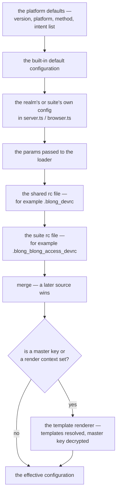

# Configuration

Blong comes with a flexible configuration mechanism, which allows the configuration to be specified
in multiple places, such as:

- the source code of each [realm](./realm)
- configuration files
- environment variables
- command line parameters

The configuration coming from these places is merged to get the effective one. The order is fixed,
and a later source overrides an earlier one:



The last step is the template renderer: every string in the merged configuration is rendered as a
JavaScript template literal, so a configuration value can refer to another — `${host}`,
`${db.connection.port}` — and the master key's secrets are decrypted there. That renderer comes in a
trusted and a safe mode; see the [template pattern](./template.md).

Environment variables are not a general merge layer in that chain: `BLONG_PLATFORM`, `BLONG_METHOD`
and `BLONG_ENV` select the platform, the method and the intent list, and `BLONG_MASTER_KEY` switches
on the template render. A component that needs a secret reads its own key instead — the gateway's
pair is resolved once at load (`gateway.sign`/`gateway.encrypt`, from an rc file, an `{env}`, or a
`{generate}`), handed to both the gateway and the rpc client that verifies with it, and generated
with a warning only when nothing configured one.

## Intents and use cases

The configuration is usually split into several parts, which are activated based on the intent.
There are some established names for the intents:

- `default`: the base configuration, active for all cases
- `dev`: development features — hot reload, the introspection endpoints, error detail in RPC replies
- `release`: the block every deployed stage shares (uat, staging, production)
- `microservice`: run a realm on its own — its adapters, orchestrators and listeners
- `integration`: the extra layers and behaviour a test needs
- `upgrade`: active during database creation
- `k8s`: write a deployment tree instead of serving
- `cli`: run a command in-process and exit

## Source code configuration

The configuration coming from the source code has the purpose to define some defaults for the
appropriate use cases and environments.

### Adapter

To configure the adapter, use one of the possible configuration places:

In the same realm where the adapter is defined, define defaults and per environment configuration

```js
// realmname/server.ts
import {realm} from '@feasibleone/blong';

export default realm(blong => ({
    config: {
        default: {
            adaptername: {
                // base configuration
                // usually namespace and imports are specified here
            },
        },
        dev: {
            adaptername: {
                // dev env overrides
            },
        },
    },
}));
```

In the global configuration, override the defaults using:

```yaml
realmname:
    adaptername:
        # global overrides
```

### Orchestrator

Orchestrators are configured the same way as adapters

### Internal components

The internal components of the framework can also be configured using the following:

```yaml
log: # global logging config
    logLevel: info # see pino config
    transport: # see pino config
watch:
    logLevel: info # log level for the watch component
adapter:
    logLevel: info # default log level for all adapters
gateway: # configuration of the API gateway
    logLevel: info # log level
    debug: true # turn on debugging details in responses
    host: 0.0.0.0 # listen address
    port: 8080 # listen port
    sign: # MLE signing key
    encrypt: # MLE encryption key
    jwt: # OpenId configuration
        audience: # JWT Audience
rpcServer: # configuration for the internal RPC calls
    logLevel: info # log level
    host: 0.0.0.0 # listen address
    port: 8091 # listen port
```

## Validation

Declare the keys a component accepts, and the load checks the merged config against them — an
unknown key or a type mismatch fails startup with the offending path named:

```typescript
// realm/adapter/db.ts
export default adapter(blong => ({
    extends: 'adapter.knex',
    validation: blong.type.Object({
        namespace: blong.type.Union([blong.type.String(), blong.type.Array(blong.type.String())]),
        logLevel: blong.type.Optional(blong.type.String()),
    }),
    activation: {default: {namespace: 'db/$subject'}},
}));
```

The check is composed from the module's structure as well as the schema, so a child key, a
registered port's name and a key the module's own source names are legitimate without being
declared. See the [configuration concept](../concepts/configuration.md#validation) for the two
deliberate limits.

## Where the configuration came from

A root load writes one `config.load` record naming the rc files, the environment variable names and
the command-line keys it read — names only, never values.
