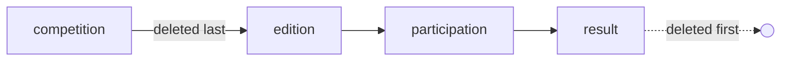

# Deletion modes

How to declare what deleting a record does, per model.

See [Deletion](../concepts/deletion.md) for the idea and the
[model system](../concepts/blong-model.md) for the pages a model generates.

---

## Declaring the mode

`deletion` is one property of an `IModelSpec`. Nothing else is needed: the browse page's own Delete
button carries it.

```typescript
// meta/model/sportAthleteModel.ts — a profile asks first
export default model(
    () =>
        async function sportAthleteModel() {
            return {
                subject: 'sport',
                object: 'athlete',
                objectTitle: 'Athlete',
                public: true,
                deletion: {mode: 'prompt'},
                // …
            };
        },
);
```

The default is `{mode: 'prompt'}`, filled in by `withDefaults` (`@feasibleone/blong-mock`), so a
model that declares nothing still asks before it deletes.

| Field          | Type                                               | Effect                                                               |
| -------------- | -------------------------------------------------- | -------------------------------------------------------------------- |
| `mode`         | `'prompt' \| 'cascade' \| 'block' \| 'deactivate'` | How a delete request resolves. Default `prompt`.                     |
| `scan`         | string                                             | Action that counts dependants. Default `<subject>.<object>.scan`.    |
| `flag`         | `{field: string; value?: unknown}`                 | `deactivate`: the column to set, and the value (default `inactive`). |
| `cascadeParam` | string                                             | The removal param that takes dependants along. Default `cascade`.    |
| `entity`       | string                                             | Filled by the aggregator: `<subject>.<object>`.                      |
| `keyField`     | string                                             | Filled by the aggregator from the model.                             |
| `edit`, `get`  | string                                             | Filled by the aggregator: the model's edit and get methods.          |

---

## What each mode does

| Mode         | The button does                                                | Reach for it when                                                   |
| ------------ | -------------------------------------------------------------- | ------------------------------------------------------------------- |
| `prompt`     | Asks, naming the counts; accepting removes them in one delete. | A record a person owns, and losing what hangs off it is a decision. |
| `cascade`    | Removes the record and everything that refers to it, silently. | A row that only exists inside a parent — a participation, a result. |
| `block`      | Refuses and names what still refers to the record.             | Reference data other records point at — a sport, a discipline.      |
| `deactivate` | Sets a flag column instead of removing anything.               | History that must keep reading — an area a specialist held.         |

The refusal a `block` produces, in the operator's words rather than a constraint name:

```text
Cannot delete this record: 1 athlete, 1 category, 1 discipline … still refer to it.
```

---

## The scan

`prompt` and `block` decide from an answer the server gives: `<subject>.<object>.scan`, with the
record's key as its params, the way a delete is addressed.

```bash
curl -s -X POST http://localhost:8099/sport/sport/scan \
    -H 'content-type: application/json' \
    -d '{"params":{"sportId":"<id-from-the-page>"}}'
```

```json
{
    "dependants": [
        {"table": "sport_athlete", "column": "primarySportId", "label": "athlete", "count": 1},
        {"table": "sport_competition", "column": "sportId", "label": "competition", "count": 2}
    ],
    "total": 3
}
```

Three things about the answer:

- **The route is generated.** `subject.validation` declares a `scan` for every model that is
  `public: true`, so a realm writes no handler and seeds no capability. The route is authorized by
  the object's `remove` action (`authorizeAs` on the validation): whoever may delete a record may
  learn what a delete would take with it.
- **The counts come from the database.** They are read from `INFORMATION_SCHEMA`, one query per
  referencing column, so a table added without touching any configuration is still counted. Rows the
  record's own row _extends_ are left out — an athlete's `party_person` row is its identity, not
  something a delete takes with it.
- **The label is the entity's own name.** `sport_conferral` reads as `conferral`, `party_person` as
  `person`.

A realm that wants a different answer names its own action in `deletion.scan`.

---

## The cascade

`cascade` (and an accepted `prompt`) removes the record with `{cascade: true}`. The adapter then
walks the foreign keys outwards from the record and back in, deleting deepest first — the only order
in which no constraint is violated on the way down.



What that means in practice, on `realm/blong-sport`'s competition chain:

- One delete removes the competition, its editions, the participations in them and the results of
  those participations, in a single transaction.
- A cascaded row that was itself resource-backed (a document, say) has its `core_resource` row
  removed too, so a cascade does not leave the orphans a plain delete used to.
- Graph edges and the flattened paths are left to the removal path that already maintains them.
- A self-reference (a result that replaces another result) is not followed in a circle.

A delete **without** the flag, over HTTP, is answered with the same counts the page would show
instead of MySQL's constraint name:

```json
{
    "code": -32000,
    "message": "Cannot delete this sport: 1 coaching, 2 competition … still refer to it"
}
```

---

## Deactivate

`deactivate` changes one column instead of removing the row. The page reads the record first and
sends it back with the flag set, because the edit is validated against the model and one changed
column is not a whole record:

```typescript
deletion: {mode: 'deactivate', flag: {field: 'areaStatus', value: 'inactive'}},
```

The row stays in the table, its status changes, and the list refreshes like any other edit. Nothing
in the framework hides a deactivated record — a realm that wants that filters it in its `find` or
offers it as a status the page can filter by.

---

## Choosing a mode

| Entity                                                 | Mode         | Why                                                                    |
| ------------------------------------------------------ | ------------ | ---------------------------------------------------------------------- |
| Profile (athlete, coach, specialist, club, federation) | `prompt`     | The person behind it may hold another role; the dialog says what goes. |
| Classifier (sport, discipline, category, area, award)  | `block`      | Records point at it; deleting it would orphan them.                    |
| Time-bound row (participation, result, conferral, …)   | `cascade`    | It has no meaning without the record it belongs to.                    |
| Reference a history must keep reading                  | `deactivate` | The history is worth more than the row.                                |

---

## Testing a deletion mode

`realm/blong-sport/test/deletion.play.ts` is the worked example: four tests, one per mode, that
assert the _answer_ rather than a picture — the dependant scan, the dialog text, the refusal text,
and the rows left behind. There are no baselines, so the spec cannot disagree with a theme.

Two habits that keep such a spec honest:

- **Create the fixtures through the server**, not through five forms: the page's handler proxy is on
  `window.__blongHandler` in a `testHook` run, so `page.evaluate` can call `sport.athlete.add` and
  the rest directly, and the test is about the delete.
- **Purge by name first**, so a retry finds the rows an earlier attempt left. A cascade does most of
  it; a record in `deactivate` mode is removed by id, because the page can only hide it.

---

## Where it lives

| Concern                              | File                                                              |
| ------------------------------------ | ----------------------------------------------------------------- |
| The spec, and the type of each field | `core/blong/widget.ts` (`IDeletionSpec`, `IToolbarButton`)        |
| The default the model system fills   | `core/blong-mock/defaults.ts`                                     |
| The button's four behaviours         | `core/blong-browser/src/components/ActionButton/ActionButton.tsx` |
| Which button carries the mode        | `core/blong-browser/src/model/component/subjectObjectBrowse.ts`   |
| The `scan` route                     | `core/blong-mock/index.ts` (`validation`)                         |
| The foreign-key walk and the counts  | `core/blong-gogo/src/adapter/schema/knex/relations.ts`            |
| The `scan` and `remove` operations   | `core/blong-gogo/src/adapter/server/knex.ts`                      |
