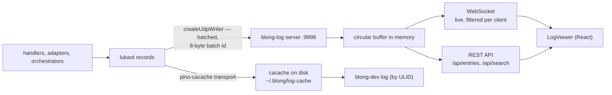
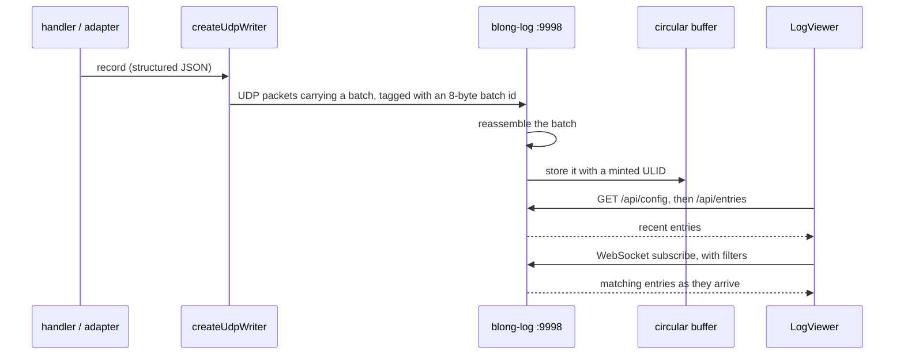

# Real-Time Log

The Blong framework ships with a real-time log viewer. `blong-log` serves the viewer and its REST/
WebSocket API on `http://127.0.0.1:9998`, and a process feeds it through the **writer** lukaot hands
its records to — no pino in the path any more. Which writer is a matter of configuration
(`log.destination`), not of a dependency, so the framework does not name the viewer and the viewer
does not have to exist.

## How it fits together

A process writes records; the viewer keeps a recent window of them in memory and the CLI reads the
ones on disk. The two destinations are **independent**, not two views of one store, so an entry
missing from the viewer is not evidence that it was never written to disk (or the other way round):



The live path, end to end:



The batch id is what lets the server put batched packets back in order; the ULID is what gives every
entry a stable key. The **record** is what goes on the wire, not the rendered line: lukaot hands a
destination both, and a viewer given only the line could show the sentence but none of the fields a
capture row draws.

## Quick Reference

```bash
# 20 most recent entries
curl -s 'http://127.0.0.1:9998/api/entries?limit=20' | jq '.entries[]'

# Errors only
curl -s 'http://127.0.0.1:9998/api/entries?level=error&limit=10' | jq '.entries[]'

# Full-text search
curl -s 'http://127.0.0.1:9998/api/search?search=connection+refused' | jq '.entries[]'

# Filter by service name
curl -s 'http://127.0.0.1:9998/api/entries?name=gateway&limit=20' | jq '.entries[]'

# One declared signal, and one capture shape
curl -s 'http://127.0.0.1:9998/api/entries?signal=frameworkPortFailure' | jq '.entries[]'
curl -s 'http://127.0.0.1:9998/api/entries?capture=tcp.frame' | jq '.entries[]'

# Trace a request across services
curl -s 'http://127.0.0.1:9998/api/entries?traceId=abc-123' | jq '.entries[]'
```

## REST API

### GET /api/entries

Returns the most recent log entries. Supports filtering.

| Parameter | Type   | Description                                                           |
| --------- | ------ | --------------------------------------------------------------------- |
| `level`   | string | Minimum log level: `trace`, `debug`, `info`, `warn`, `error`, `fatal` |
| `name`    | string | The port or component that reported it — `fields.context`, substring  |
| `signal`  | string | One declared identifier, exact match                                  |
| `capture` | string | One capture shape: `tcp.frame`, `http.exchange`, `json`               |
| `traceId` | string | Exact trace ID match                                                  |
| `search`  | string | Free-text search across all properties                                |
| `after`   | string | Return only entries after this ULID (pagination)                      |
| `limit`   | number | Max entries to return (default: 200)                                  |

### GET /api/search

Same as `/api/entries` but searches the full buffer instead of just recent entries.

### GET /api/config

Returns server configuration including recognised property names. Useful for discovering available
filter fields.

## Common Workflows

### Check for errors after a code change

```bash
curl -s 'http://127.0.0.1:9998/api/entries?level=error&limit=5' \
  | jq '.entries[] | {msg, name, err: .err.message}'
```

### Monitor a specific service

```bash
curl -s 'http://127.0.0.1:9998/api/entries?name=orchestrator&limit=30' \
  | jq '.entries[] | {levelName, msg}'
```

### Verify an API call

```bash
# By method name
curl -s 'http://127.0.0.1:9998/api/search?search=userUserAdd' \
  | jq '.entries[] | {levelName, msg, name}'
```

### Trace a request through services

```bash
# Find the trace ID
TRACE=$(curl -s 'http://127.0.0.1:9998/api/entries?search=transfer&limit=1' \
  | jq -r '.entries[0].traceId')

# All logs for that trace
curl -s "http://127.0.0.1:9998/api/entries?traceId=$TRACE" \
  | jq '.entries[] | {name, levelName, msg}'
```

### Poll for new entries

```bash
LAST_ID=$(curl -s 'http://127.0.0.1:9998/api/entries?limit=1' \
  | jq -r '.entries[-1].id')

# Later, get only new entries
curl -s "http://127.0.0.1:9998/api/entries?after=$LAST_ID" \
  | jq '.entries[] | {levelName, msg}'
```

## Log Entry Properties

A record is lukaot's: the envelope every line carries, and the values in `fields`.

| Property    | Type   | Description                                                                |
| ----------- | ------ | -------------------------------------------------------------------------- |
| `id`        | string | ULID — monotonically increasing, sortable                                  |
| `time`      | number | Unix timestamp in milliseconds                                             |
| `level`     | number | 10=trace 20=debug 30=info 40=warn 50=error 60=fatal                        |
| `levelName` | string | Human-readable level name                                                  |
| `msg`       | string | The sentence the declaration (or the call) carries                         |
| `service`   | string | The service that wrote it                                                  |
| `signal`    | string | The declared identifier — promoted out of `fields` for a sink that indexes |
| `fields`    | object | The line's own values: `context`, `params`, `capture`, `shape`, `rung`, …  |
| `err`       | object | The failure: `{type, message, stack}`                                      |
| `refs`      | object | `record`, `template`, and `parent` when the line continues another         |
| `traceId`   | string | Distributed trace ID                                                       |
| `req`/`res` | object | The pre-lukaot HTTP shape, still rendered when a record carries it         |

The **`Where`** column is `fields.context` — the port's instance id (`srv.db`) or the component's
class name — because with one service writing every line it is the identity a reader filters by.

## Captures

A capture is a payload record: `fields.capture` names the declaration, `fields.shape` says which
renderer produced it and `fields.rung` says how much was kept (`line`, `headers`, `body`, `full`,
`hex`, `keys`). The viewer draws each of the three shapes the way it reads best:

- **`http.exchange`** — the phase, the request line or the status, the headers, and the body as
  JSON.
- **`tcp.frame`** — a hex dump: offset, sixteen bytes per row, and their ASCII beside them, which is
  how a text protocol opening (`0200`, an MTI, a PEM header) is visible without decoding the bytes.
- **`json`** — the keys first, then the document.

Expanding a capture row draws the payload, headed by the shape itself — `tcp.frame`, `rung full`,
`out`, `40 B` — so the panel says what it is without the row repeating the sentence it was logged
with. The `⌗` mark in the `Signal` column says a row carries one. A capture kept at the `line` rung
has no payload and says so, which is the difference between a payload that was never configured and
one that was configured too cheaply.

## What else a record says

A line is not only a sentence. Above it, an expanded row draws the rest as a strip of chips: the
**intent** it ran under (`release-cd (deployer@comesa)`), the **flow** and step it is in, the
**leg** it is one end of (`controller → cluster · 1.2`) with the run's status, the record that
**caused** it, and the **decision** it reports. Every chip naming an identifier is a filter — the
run id asks the table for the rest of that run, the parent for the record that caused this one —
which is what makes the strip a place to start reading from rather than a datum to copy out.

A decision gets a panel of its own under the strip: the candidates in **evaluation order** with the
chosen one marked, because the order is the rule being explained. The values it was decided from are
usually absent — retained in the process that decided rather than transmitted — and the panel says
so instead of drawing an empty block.

A request and a response are read in **either spelling**: lukaot writes `operation`/`target` and
`status`/`elapsedMs`, and a record from before the conversion wrote `method`/`url` and
`statusCode`/`responseTime`. `exchangeOf` knows both, so a framework record no longer renders as an
empty request line.

The two wide columns expand **independently**: clicking (or pressing space in) the message opens the
record's detail, the same in the JSON column opens the record itself. The space bar toggles
whichever of the two the focused cell belongs to, the way it toggles a disclosure in a file tree.

A row is drawn at a height derived from the record — the dump's rows, the document's lines, the
sentence — and never measured, so scrolling the table past an expanded row does not re-draw it
collapsed for a frame. The detail scrolls inside its own viewport once it outgrows the cap, which is
what keeps its end reachable instead of pushing the rows below it out of the table.

## Running it locally

```bash
cd tools/blong-log
node build-client.js # once, and after a change to the client
node src/cli.ts # viewer on http://127.0.0.1:9998
```

Then point a process at it. The framework reads `log.destination` from its configuration, so there
is nothing to add to the code:

```yaml
log:
    destination: {port: 9999} # host too, when the collector is not on this machine
```

The sink itself is lukaot's — `createUdpWriter` in `@feasibleone/lukaot/node` — so the address is
all a process has to know: nothing extra to install, and no viewer package named in a configuration.
`destination: 'udp://collector:9999'` and `destination: true` (defaults) are the same thing in the
other spellings.

A destination the framework does not ship is a **module**: the loader imports it and calls its
**default export** with the options, and what comes back must be a lukaot `Writer` — an object with
`write(line, record)`.

```yaml
log:
    destination: {module: './tools/my-writer.ts', options: {…}}
```

The module name is resolved from the working directory the configuration was read from, so a bare
package name means "installed beside the process" and a relative path names a file.

A destination is **added** to what a process already writes, never a replacement: the terminal keeps
its copy and the collector gets one too. Installing it as the only writer silenced the process
completely — a run that says "nothing to run" on stdout said nothing at all, and the test that waits
for that line hung for its full two minutes.

A destination that cannot be built is reported through the log
(`log.destination: … could not be imported; records stay where they were`) and then skipped: a wrong
collector address costs the records it would have received, never the process that was writing them.
One that loads is closed with the process — `close()`, then `flush()` — so the last batch is sent
rather than lost in a socket's queue.

The same thing in code, for a process that decides for itself:

```ts
import {createUdpWriter, setWriter} from '@feasibleone/lukaot/node';

setWriter(createUdpWriter({port: 9999}));
```

Either way the addresses the viewer is told (`/api/config`) are taken from the request that asks, so
a page reached through a forwarded port, an ingress or another host name talks to the server that
served it.

## Deploying it

In a suite the viewer is a realm (`realm/blong-viewer`), not a program installed beside the
deployment: its adapter receives the records the other processes send, and its gateway layer serves
them to the page over the same session and the same capability model as every other page
(`@@D-946`). Two consequences follow, and both are what a deployment sees:

- **The address is a realm fact.** The adapter claims the `viewer` namespace and contributes the UDP
  port it listens on (`k8sPorts`), so the tree publishes a Service named after the realm carrying
  `rpc`, `http` and that port. A realm that opens a port is reached at the realm's name in every
  profile, which is why a suite can write the address down without knowing how it is split
  (`@@D-951`).
- **The destination is the suite's own configuration.** Nothing in the deployment engine knows about
  a viewer: the processes are pointed at one with the framework's ordinary `log.destination`, and a
  suite that leaves the realm out has simply not written that block.

```ts
config: {
    k8s: {viewer: {}},
    release: {
        // Every pod of the deployment, the migration Job included, sends its records here.
        log: {destination: {host: 'viewer', port: 9999}},
    },
}
```

The realm's page is a portal contribution like any other — Observability → Logs — and the capability
that opens it is seeded into `blong-access` by the deployment's migration (`viewerRead`). A tenant
that does not want the viewer in a tree switches the realm off, which removes its process, its layer
flags and its Service together:

```ts
config: {kustomize: {deploy: {realms: {viewer: {enabled: false}}}}}
```

## Runtime Introspection Endpoints

For inspecting the framework's internal state (registered adapters/orchestrators, handlers, config),
enable the `systemDebug` endpoints in the suite's `server.ts` (dev only — never in production):

```ts
config: {
    dev: {
        gateway: {debug: true},        // include stack traces in error responses
        systemDebug: {enabled: true},  // expose /api/sys/* endpoints
    },
}
```

| Endpoint               | Returns                                       |
| ---------------------- | --------------------------------------------- |
| `GET /api/sys/config`  | Effective merged runtime configuration        |
| `GET /api/sys/ports`   | All registered adapter/orchestrator names     |
| `GET /api/sys/methods` | All handler method groups with handler counts |
| `GET /api/sys/modules` | All registered realm module names             |
| `GET /api/sys/rpc`     | Internal RPC server address                   |

### Typical troubleshooting workflow

```bash
# Is the expected adapter/orchestrator registered?
curl -s http://localhost:8080/api/sys/ports | jq '.ports[]'

# Are the expected handlers present?
curl -s http://localhost:8080/api/sys/methods \
  | jq '.methods[] | select(.name | contains("myRealm"))'

# What is the effective config?
curl -s http://localhost:8080/api/sys/config | jq '.myRealm.myAdapter'

# Correlate with logs
curl -s 'http://127.0.0.1:9998/api/entries?level=error&limit=10' \
  | jq '.entries[] | {msg, name}'
```

## The on-disk cache

The `pino-cacache` transport keeps entries in a `cacache` directory (`cachePath`, default
`~/.blong/log-cache`) so `blong-dev log <ulid>` can fetch one later. Two properties of that store
are worth knowing:

- **Retention deletes the entry's index file.** A `cacache` key hashes into an index file of its
  own, so marking a pruned entry as deleted instead of removing the file leaves one file per entry
  ever written and makes every later read of the truth read all of them. The transport removes the
  file (`removeFully`), and so does the semantic store that shares the directory.
- **The semantic store keeps a secondary index** (`order.jsonl`, append-only) and reads that instead
  of `cacache`'s index, which is one file per key. The transport keeps none: it is protected by the
  store's interval sweep, which reconciles against `cacache` and prunes to the same bound.
- **A slow retention pass is reported.** The transport runs in a pino worker thread with no logger,
  so it writes to stderr when its index scan or its retention pass takes longer than a second — the
  same margin the rest of the framework uses for a slow step. A retention that _fails_ is reported
  there too, rather than swallowed: a pass that never runs is indistinguishable from one that found
  nothing to do, and the difference is a cache that grows without bound.

## Implementation

The log viewer lives in `tools/blong-log/`. It exposes a React `LogViewer` component (used in the
browser) and a server that stores log entries forwarded from Pino.

For more on the design rationale see [rationale/real-time-log](../rationale/real-time-log.md).
