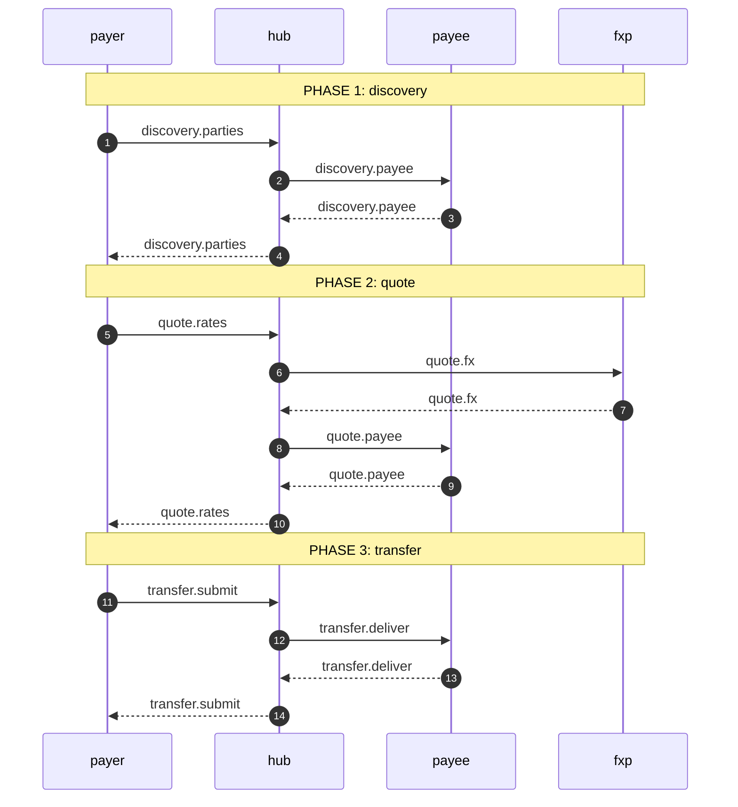
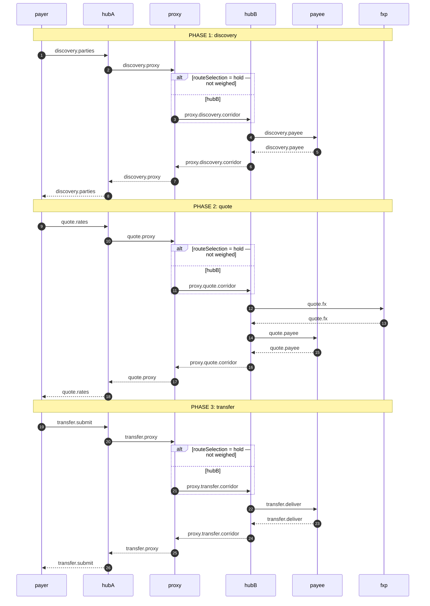

# The flows a run observes

Two transfer topologies live in `core/lukaot/flow/`: real HTTP between real processes, every
participant declaring its own vocabulary, and every arrow in the diagrams below drawn from what the
service **observed** of one execution rather than from a document.

This page annotates the diagrams leg by leg, so they can be read against the code that produced
them. The declaration reference is the [pattern guide](./lukaot.md), what the library is at all is
the [concept](../concepts/lukaot.md), and why the identity is declared rather than derived is the
[rationale](../rationale/lukaot.md).

## These flows are a demonstration

They are **demonstration fixtures for the vocabulary**. They are not an implementation of Mojaloop,
not a payment system, and not a model of how settlement should be built. Their purpose is to
generate realistic multi-service traffic — real HTTP between real processes, real failure paths,
records read back out of each participant's own cache — so that the behaviour can be watched,
asserted and drawn.

They are **loosely based** on two published Mojaloop features:

| Flow                                  | Based on                                                                                                                                                                                              |
| ------------------------------------- | ----------------------------------------------------------------------------------------------------------------------------------------------------------------------------------------------------- |
| `single` — cross-currency, one scheme | [Foreign Exchange — currency conversion](https://docs.mojaloop.io/product/features/fx.html): a Payer DFSP obtains a conversion rate from an FXP and then executes the transfer in the target currency |
| `inter` — cross-border, two schemes   | [Interscheme](https://docs.mojaloop.io/product/features/interscheme.html): two schemes joined by a **proxy participant** that routes for adjacent DFSPs/FXPs in the other scheme                      |

### What is simplified or omitted, deliberately

| In the Mojaloop flow                                                                                                                                              | In these fixtures                                                                                                         |
| ----------------------------------------------------------------------------------------------------------------------------------------------------------------- | ------------------------------------------------------------------------------------------------------------------------- |
| An **Oracle** resolves the party identifier, and `GET /parties` is answered with a `PUT /parties/{ID}`                                                            | Three generic `POST` routes — `/parties`, `/quotes`, `/transfers` — with no directory; the payee answers directly         |
| Two `POST /quotes` rounds (liquidity cover from the FXP, then the transfer terms from the payee), plus the Payer's own confirmation step                          | One quote round: the provider's rate is threaded through the payee and returned to the payer once                         |
| An FX marketplace: several FXPs bid for the conversion and the DFSP selects one                                                                                   | One provider for the corridor, by configuration                                                                           |
| Real ILP cryptographic conditions and fulfilment preimages                                                                                                        | Placeholder strings (`sha256:condition`, `sha256:preimage`); nothing is cryptographically verified                        |
| Two-phase reserve/commit across ledgers, atomic settlement, clearing accounts                                                                                     | A single `withhold` and its release on failure — which is the observability the fixture needs to demonstrate              |
| Abort flows                                                                                                                                                       | A refusal status (409, 422, 503) and an error record                                                                      |
| Inter-scheme discovery by broadcast, cached identifiers, stale-cache self-healing, proxy registration through an admin API, and `GET /transfers` resolved locally | Absent: the corridor is configured rather than discovered, and the proxy's routing decision is a single recorded decision |
| Non-repudiation: the proxy routes but takes **no part in the agreement of terms**                                                                                 | **Preserved** — the proxy forwards `/quotes` unchanged and adds no terms of its own                                       |

The rates, amounts and identifiers are invented. No participant holds state that survives a run, and
nothing here is a statement about how a real scheme should behave.

## How to read the annotations

Every arrow is a call a record declared, and every label is the **leg id the source declares** —
`transfer.deliver` in a diagram is a literal in `flow/hub.ts`, and the table under each diagram
names the file and line that declares it. That is what makes a picture of a run lead its reader back
to the code without guessing.

Each diagram uses mermaid's `autonumber`, which numbers **arrows only** — the `Note over …` lines
carry no number. The table is the diagram in full, and it says what a picture cannot:

| Column              | Meaning                                                                                                                     |
| ------------------- | --------------------------------------------------------------------------------------------------------------------------- |
| `call`              | the leg id, as declared in the code                                                                                         |
| `caller → receiver` | who declared the call, and who they declared it to — the receiver the caller _named_, not one inferred from who answered    |
| `phase`             | the step the call was observed in (`discovery`, `quote`, `transfer`)                                                        |
| `position`          | the counter path the caller assigned: `2.2.1` is the first call made while answering `2.2`                                  |
| `declared`          | how many declarations were observed — one per execution, so a chatty call site is still one call                            |
| `answered`          | of those, how many had their receiver observed too. **`0` is the interesting case**: the call was made and nothing answered |
| `declared in`       | the file and line that declares the id                                                                                      |

An arrow drawn with a cross (`--x`) is a call the caller declared that nothing answered — a receiver
that is missing, failing, or wired to the wrong address. An arrow drawn dashed (`-->>`) is the
receiver's own record of the leg: the answer on its way back, under the same id, drawn where it
arrived — after everything that call itself called has been answered. A call that never leaves its
own participant is the one call drawn without a pair, because the answer to it would repeat the same
caller, the same label and the same step.

A branch is an `alt`/`else` block whose arms are named for the candidates the code declared. Here
the arm labels come from a **declared decision** (`proxyVocabulary.decision.routeSelection`), so the
block names the choice the code makes rather than a phrase somebody typed.

Regenerate both blocks with:

```bash
cd core/lukaot
LUKAOT_UPDATE_DIAGRAMS=1 node test/flow/observedFlows.test.ts
```

## Cross-currency (single scheme)

Four participants: `payer`, `hub`, `fxp` (the FX provider), `payee`. Wired by `startFlow('single')`
in `flow/flows.ts`; each is created with its own vocabulary — `payerVocabulary`, `hubVocabulary`,
`payeeVocabulary`, `fxpVocabulary` — so a record's identity names the declaration the participant
made.

Relative to the published exchange, this fixture:

- **collapses the two quote rounds into one** — the payer sends one `POST /quotes` that carries both
  the FX request and the main quote, and the hub threads the provider's rate through the payee and
  merges both answers into the single reply;
- **does not model the FX provider's transfer legs** — the provider is consulted in the quote phase
  only, and the hub settles directly with the payee. A second settlement participant would add no
  new observability, so its absence is a decision rather than an oversight;
- **keeps the liquidity reservations out of the wire** — the hub's `withhold({liquidity})` is
  retained in the record and never transmitted, which is why no leg carries it;
- **records its branches** — the payer's `quoteAcceptable` and the provider's `rateWithinLimit` are
  decided inside the participant that owns them, so the rationale lands on that participant's next
  record.

<!-- BEGIN OBSERVED FLOWS: transfer.single -->
Participants: `payer`, `hub`, `payee`, `fxp`. 7 calls observed across 1 execution(s).



| call | caller → receiver | phase | position | declared | answered | declared in |
| ---- | ----------------- | ----- | -------- | -------- | -------- | ----------- |
| `discovery.parties` | `payer` → `hub` | discovery | 1 | 1 | 1 | `flow/payer.ts:116` |
| `discovery.payee` | `hub` → `payee` | discovery | 1.1 | 1 | 1 | `flow/hub.ts:114` |
| `quote.rates` | `payer` → `hub` | quote | 2 | 1 | 1 | `flow/payer.ts:127` |
| `quote.fx` | `hub` → `fxp` | quote | 2.1 | 1 | 1 | `flow/hub.ts:115` |
| `quote.payee` | `hub` → `payee` | quote | 2.2 | 1 | 1 | `flow/hub.ts:116` |
| `transfer.submit` | `payer` → `hub` | transfer | 3 | 1 | 1 | `flow/payer.ts:166` |
| `transfer.deliver` | `hub` → `payee` | transfer | 3.1 | 1 | 1 | `flow/hub.ts:117` |
<!-- END OBSERVED FLOWS: transfer.single -->

## Inter-scheme cross-currency

Six participants: `payer`, `hubA`, `proxy`, `hubB`, `payee`, `fxp`. Wired by `startFlow('inter')`.
One provider sits on the corridor and the receiving scheme's hub asks it; the originating hub quotes
nothing locally, so the corridor's price is the only price the run records — the shape the published
flow has.

Relative to the published exchange, this fixture:

- **routes the corridor through a proxy participant** — hub A holds no directory of its own, so
  `discovery.proxy` is a real hop to a real participant rather than a URL change;
- **carries each phase end to end** — one leg per hop per phase, which is what makes the counter
  paths read as a depth-first walk of the corridor (`1.1.1.1`, `2.1.1.2`, `3.1.1.1`);
- **records the routing decision where it is made** — the proxy's `routeSelection` decision has two
  arms, `hubB` (reachable, so the call is forwarded) and `hold` (no corridor configured, so the call
  is held with 503 rather than lost). The happy run takes `hubB`, which is why the block shows the
  other arm as not weighed.

<!-- BEGIN OBSERVED FLOWS: transfer.inter -->
Participants: `payer`, `hubA`, `proxy`, `hubB`, `payee`, `fxp`. 13 calls observed across 1 execution(s).



| call | caller → receiver | phase | position | declared | answered | declared in |
| ---- | ----------------- | ----- | -------- | -------- | -------- | ----------- |
| `discovery.parties` | `payer` → `hubA` | discovery | 1 | 1 | 1 | `flow/payer.ts:116` |
| `discovery.proxy` | `hubA` → `proxy` | discovery | 1.1 | 1 | 1 | `flow/hubA.ts:93` |
| `proxy.discovery.corridor` | `proxy` → `hubB` | discovery | 1.1.1 | 1 | 1 | `flow/proxy.ts:82` |
| `discovery.payee` | `hubB` → `payee` | discovery | 1.1.1.1 | 1 | 1 | `flow/hub.ts:114` |
| `quote.rates` | `payer` → `hubA` | quote | 2 | 1 | 1 | `flow/payer.ts:127` |
| `quote.proxy` | `hubA` → `proxy` | quote | 2.1 | 1 | 1 | `flow/hubA.ts:125` |
| `proxy.quote.corridor` | `proxy` → `hubB` | quote | 2.1.1 | 1 | 1 | `flow/proxy.ts:83` |
| `quote.fx` | `hubB` → `fxp` | quote | 2.1.1.1 | 1 | 1 | `flow/hub.ts:115` |
| `quote.payee` | `hubB` → `payee` | quote | 2.1.1.2 | 1 | 1 | `flow/hub.ts:116` |
| `transfer.submit` | `payer` → `hubA` | transfer | 3 | 1 | 1 | `flow/payer.ts:166` |
| `transfer.proxy` | `hubA` → `proxy` | transfer | 3.1 | 1 | 1 | `flow/hubA.ts:157` |
| `proxy.transfer.corridor` | `proxy` → `hubB` | transfer | 3.1.1 | 1 | 1 | `flow/proxy.ts:84` |
| `transfer.deliver` | `hubB` → `payee` | transfer | 3.1.1.1 | 1 | 1 | `flow/hub.ts:117` |
<!-- END OBSERVED FLOWS: transfer.inter -->

### What the diagrams do not draw

The generated blocks draw what the service **observed**; three things the fixtures carry are absent
from them, and each is deliberate:

| Addition                          | Where                              | Why it is there                                                                                                                                                                                                                                              |
| --------------------------------- | ---------------------------------- | ------------------------------------------------------------------------------------------------------------------------------------------------------------------------------------------------------------------------------------------------------------ |
| The proxy's `hold` arm            | `proxy.ts` (`ROUTES`, `reachable`) | a proxy whose receiving link is not configured has no route and must hold (503) rather than forward into an address it was never given. Reachability is derived from the deployment, so the arm is real and not a guard against something that never happens |
| Two identity headers on every hop | `participant.ts` (`hop`)           | `x-semantic-trace` (causal correlation) and the execution id it carries — the diagram draws the protocol, not the observability envelope                                                                                                                     |
| The optional service sink         | `participant.ts`, `flows.ts`       | with `--service`, each participant's records are shipped **beside** the local cache; without it the run is complete and offline                                                                                                                              |

## What the flow code demonstrates

Every item below happens where a real service would do it — these are calls a service makes at that
point, not demonstration code — and each is pinned by a test rather than by this page.

| Feature                                                    | Where the fixture does it                                                     | Pinned by                                                             |
| ---------------------------------------------------------- | ----------------------------------------------------------------------------- | --------------------------------------------------------------------- |
| One real process per participant, over real HTTP           | `participant.ts` (`createParticipant`, `listen`, `hop`)                       | the artifact test runs both topologies end to end                     |
| A vocabulary per participant, composed at creation         | `flows.ts` (`VOCABULARY`), `participant.ts` (`compose(runtime, participant)`) | `src/decide.test.ts` and the fixture's own records                    |
| The identity on a record is the declared name              | `signal?.<id>?.(…)` in every participant                                      | the `declared in` column resolves each label to its source            |
| A branch records its arms and the one taken                | `decide(vocabulary.decision.…)` in the payer, the provider and the proxy      | the `alt` blocks in the diagrams above                                |
| A decision switched off still decides, and records nothing | `decide` returns the arm's result before it stages any rationale              | `src/decide.test.ts` — "a decision switched off still decides…"       |
| Calls are declared by both ends                            | `hop` carries the identity headers; each participant adopts the inbound leg   | the paired arrows, `answered` = `declared` in every row               |
| Withheld detail belongs to the execution that withheld it  | `participant.logger.withhold(…)` inside the switch                            | each participant's own store, read back after the run                 |
| A refusal stops the chain and travels as a status          | every route sets `reply.status(result.status)`, never returns the envelope    | the payee's 422 and the proxy's 503 in a fault run                    |
| Faults are deployment properties, not test branches        | `startFlow(kind, {faults})` → `install*` options                              | the runner's flag parsing; fixture-level fault assertions are pending |
| Offline: nothing needs to be running                       | no `serviceUrl` → readable output, references and the local cache alone       | the runner's default mode                                             |
| A service sink is a **second** destination                 | `serviceUrl` → `createServiceWriter`, beside the local cache                  | the artifact test, which reads its diagrams from that sink            |
| The last record is flushed before the cache closes         | `close()` flushes loggers, then sinks, then the cache                         | every read-back in the artifact test                                  |

### Faults

A fault is a **deployment property** handed to `startFlow`, never a branch a test steers a
participant into. The runner accepts them as flags:

| Fault                | Configuration           | What it makes reachable                                                       |
| -------------------- | ----------------------- | ----------------------------------------------------------------------------- |
| F1 payee refuses     | `faults.blockTransfers` | the far end is the origin of a failure; withheld detail is released on it     |
| F2 payer retries     | `faults.retries = 40`   | one execution per attempt, and one identity for unchanged code                |
| F4 payee stalls      | `faults.stallTransfers` | the last step reached is recorded, so a stalled flow says where it stopped    |
| F5 provider declines | `faults.declineRate`    | the declined arm of a decision is what the record shows, not just the failure |

A fifth fault, F3 — "the hub's liquidity message is reworded, as a deploy would" — no longer exists:
a message belongs to a declaration now, so the only place a reword can happen is the vocabulary
file, and nothing about the record's identity moves with it.

Some of these were exercised end to end by the previous package's fixture suites, which were not
ported with the artifact. The flags are wired and the runner accepts them; the assertions that read
each participant's records back per fault are still to come.

## Running and testing the flows

`node flow/run.ts --flow single|inter` runs a flow by hand; see the
[pattern guide](./lukaot.md#running-the-fixtures) for the runner's flags.

> Links to the package's sources are given as paths rather than hyperlinks: the docs site is built
> from `docs/blong/docs/` alone, so a link escaping this tree would be a broken link in the
> published site.
