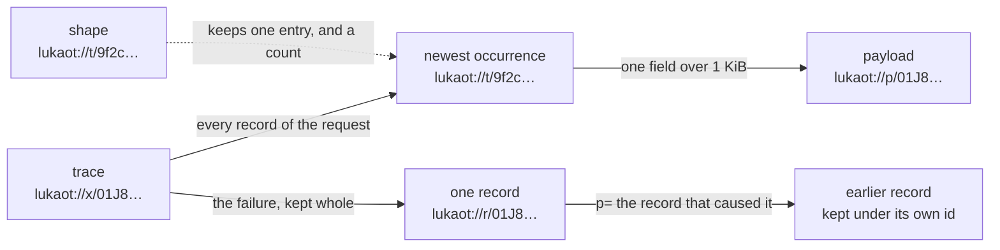

# A line's references

A lukaot record is rendered as one header line, and the line ends with a bracketed group of
references. This page is the single place that says what each member of that group is, what it
resolves against, and what it is for when a line turns out to be the one worth following.

The examples below are real shapes, shortened to the width of a page:

```text
2026-11-28T10:11:12.345Z info  gateway fxp.quote rate declined: 1.2 above 1.15 [lukaot://t/9f2c4a1b8e07 lukaot://x/01J8Z9K2M9WQ4C7T0N6G3B1VD]
2026-11-28T10:11:12.401Z error gateway fxp.quote ECONNREFUSED 10.0.0.7:8443 [lukaot://r/01J8Z9K2M9WQ4C7T0N6G3B1VE lukaot://t/9f2c4a1b8e07 lukaot://x/01J8Z9K2M9WQ4C7T0N6G3B1VD p=01J8Z9K2M9WQ4C7T0N6G3B1VC]
```

## The five members

| Member       | Form                 | Names                                | Printed when                                                                     |
| ------------ | -------------------- | ------------------------------------ | -------------------------------------------------------------------------------- |
| **template** | `lukaot://t/<shape>` | the newest record of a shape         | the record has a shape, which is every record with a fingerprint                 |
| **record**   | `lukaot://r/<ulid>`  | one emitted record, under its own id | folding it into its shape would hide something (a withheld payload, or an error) |
| **trace**    | `lukaot://x/<id>`    | the request the record belongs to    | the record was emitted inside a trace                                            |
| **payload**  | `lukaot://p/<ulid>`  | a value too large to inline          | not in the group — it stands **in place of the value** on a detail line          |
| **parent**   | `p=<ulid>`           | the record that caused this one      | the record has a causal parent in its async scope                                |

A **shape** (also called a template) is the record's identity with the values that vary between
occurrences masked — the retry count, a duration, an amount. The store keeps one entry per shape and
counts the occurrences, which is what lets a shape every run emits keep its place while a record
seen once ages out. That is why a shape reference resolves to the _newest_ occurrence rather than to
a list.



## What each is for

The group exists so that a line you did not expect is a **starting point** rather than a dead end.
Read it in the order the trouble takes you:

1. **`lukaot://t/<shape>` — what kind of line was this?** The shape's entry is the newest occurrence
   of it, so opening it answers "what does this line look like when it happens, and how often has it
   happened". A shape that repeats is normal; a shape that appeared once is the one to read.
2. **`lukaot://r/<ulid>` — this occurrence.** Present on a failure or on a record that withheld a
   value, which is exactly when the details differ from the shape. The record carries the stack, the
   request and response detail and the payload references.
3. **`p=<ulid>` — what caused it.** The causal parent, within the same async scope. Walking it
   backwards is how a chain is read root-first; a trace groups a request, and a flow names a called
   process, but neither says which record caused which. The parent is commonly _not_ retained, since
   an ordinary record is represented by its shape — a parent that no longer resolves is a normal
   answer, not a broken line.
4. **`lukaot://x/<id>` — the request.** Everything the local store still holds under that trace. The
   store keeps one entry per shape, so this is a listing of what was on disk, not a replay: the
   service holds the full lineage the retention bound drops.
5. **`lukaot://p/<ulid>` — the value the line withheld.** A field whose serialised form reached 1
   KiB is printed as its payload reference, and the value itself is retained beside the records. A
   reference is written only when the payload was actually retained, so a payload link is never a
   dead one at the moment it is printed.

## Following one

| Where you are           | A reference is                          | Follow it by                                                |
| ----------------------- | --------------------------------------- | ----------------------------------------------------------- |
| a terminal, any process | a link in the printed line              | clicking it — the `rest-fs` extension resolves it           |
| a file open in VS Code  | a link wherever the reference is quoted | Ctrl+click, the same way any link in the editor is followed |
| a coding agent          | text in stdout                          | `blong-dev log <ulid>`, `blong-dev log --trace-id <id>`     |

The store is the same `cacache` directory for every reader — `~/.blong/log-cache` unless the process
was configured otherwise (`restfs.blongLogCachePath` for the editor, `--cache-path` or
`$BLONG_LOG_CACHE` for the CLI). A reference only resolves in a store that has the entry, so a
reference printed by one machine and read on another resolves in the reader's store or not at all.

`refs: false` in the renderer suppresses the group for a released process, whose stdout nobody reads
with a store open beside it. It does not remove the references from the record: JSON output and the
retained store always carry them.

## Why some members are conditional

The group is not a fixed list, and each absence is a fact:

- **No `r` member** means the record is faithfully represented by its shape. The store keeps it
  under the shape only, so a record link would be a link to nothing.
- **No `p=` member** means no record caused this one, or it was the first in its scope.
- **No `p/…` in a detail line** means the value was short enough to inline, or no store was
  configured: a reference nothing retains is worse than a long line.
- **No `x` member** means the process had no ambient trace — a scheduled job, a startup line.

## Related

- [lukaot concept](../concepts/lukaot.md) — the vocabulary a record is written from
- [lukaot patterns](./lukaot.md) — declaring it, and what a record carries
- [log patterns](./log.md) — the store, the CLI and the viewer
- `core/lukaot/src/refs.ts` — the scheme, the segments and the encoding, declared once
