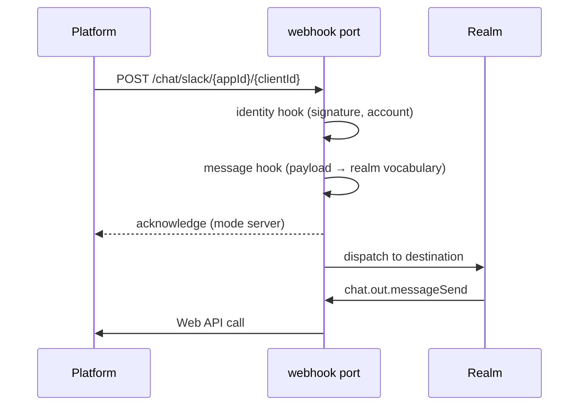

# Webhook

The webhook adapter is the one place a Blong process is _reached_ rather than reaching: a platform
posts to a path, the port verifies and maps what arrived, and a realm method decides what it means.
The same port posts out, so a service that answers a platform can also speak to it, on one
configuration.



## Configuration

Everything is co-located in the layer that attaches the port, as an `activation` block. The keys are
the port's contract, and the receiving half is off until `listen` asks for it.

| Key           | What it decides                                                                       |
| ------------- | ------------------------------------------------------------------------------------- |
| `url`         | The base of the posting half; a descriptor's `path` resolves against it.              |
| `listen`      | Starts the receiving half. Off by default: a notifier needs no socket.                |
| `server`      | Where it listens. `port: 0` is a real choice — the kernel picks and the port reports. |
| `path`        | The path a platform posts to, with `{name}` segments taken from the URL.              |
| `hook`        | The prefix of the three receiving hooks; defaults to the namespace.                   |
| `mode`        | `server` acknowledges at once and runs on; `reply` waits and answers with the result. |
| `response`    | The acknowledgement body when `mode` is `server` or nothing else answers.             |
| `destination` | The realm method an inbound message is dispatched to.                                 |
| `bodyLimit`   | Largest accepted body, in bytes.                                                      |
| `accounts`    | Whatever the port's own handlers need to find a secret per account.                   |

## The three hooks

A receiving port provides up to three handlers, named `<hook>.identity`, `<hook>.message` and
`<hook>.server`. Each missing one degrades rather than fails, which is what lets a simulator be the
same port with fewer hooks.

- **`identity`** verifies and names: a signature over the raw bytes, the account the path selects,
  the delivery id a retry repeats. A throw is answered with the error's `statusCode` and nothing
  runs.
- **`message`** maps the payload into the realm's vocabulary. It answers `false` when the request is
  understood but there is nothing to process (a challenge, a delivery of a kind the port does not
  use), and the `server` hook or the configured `response` is the whole answer then.
- **`server`** shapes the answer once the chain has run. In `reply` mode it also sees what the
  destination answered.

`webhookBodyParser('json' | 'form')` keeps `request.rawBody` beside the parsed body, because a
platform signature is computed over the bytes and not over their meaning, and maps a parse failure
to a 400.

## Both directions on one port

The posting half turns a descriptor into one HTTP call and returns what the platform said:

```ts
export default handler(({lib: {error, slackTokenGet}}) => {
    const errors = error({
        'slack.accountMissing': {message: 'No Slack account {account}', statusCode: 404},
    });
    return function slackMessageSendRequestSend(this: {config?: IConfig}, params: ISendParams) {
        const token = slackTokenGet(this.config?.accounts, params.account);
        if (!token) throw errors['slack.accountMissing']({params: {account: params.account ?? ''}});
        return {
            path: 'chat.postMessage',
            method: 'POST',
            responseType: 'json',
            headers: {authorization: `Bearer ${token}`},
            json: {channel: params.conversationId, text: params.text},
        };
    };
});
```

A descriptor is deliberately boring — path, method, headers, body — so the protocol stays in the
handlers and the transport stays in the port. The port also answers `<namespace>Webhook.address`,
which is how a port configured with `port: 0` is reached without agreeing on a number.

## Receiving is a state machine, not a callback

Four things have to happen in order, and each one is a decision the port makes so the hooks do not
have to:

1. **Acknowledge fast.** Slack allows three seconds and Viber less; a realm that took longer would
   be retried and would redo its work. `mode: 'server'` answers from `response` before the
   destination runs.
2. **Deliver once.** A retry is a platform's normal behaviour, not an error. The delivery id a
   port's `identity` hook returns is remembered for a bounded window — long enough to outlive one
   retry — and a repeat is acknowledged without running anything.
3. **Disown on request.** A `message` hook that answers `false` says the request was for the port (a
   URL challenge), and the `server` hook answers it.
4. **Stop cleanly.** The outbound stream ends with a `null` push, an `end()`, and a deferred
   `destroy()`, which is what keeps a hot reload from printing `AbortError` over the work it just
   interrupted.

## Example: chat as a platform surface

`realm/blong-chat` is the worked example. `adapter/server/slack.ts` and `adapter/server/viber.ts`
extend `adapter.webhook` with `listen`, a path built from `{appId}`/`{clientId}`, `mode: 'server'`,
a `destination` of `chat.in.receive`, and a `hook` prefix (`slackIn`, `viberIn`) whose three
handlers do the protocol work:

| Slack handler      | What it does                                                                                                |
| ------------------ | ----------------------------------------------------------------------------------------------------------- |
| `slackIn.identity` | HMAC of `v0:{timestamp}:{body}`, 300 s skew, timing-safe, one account.                                      |
| `slackIn.message`  | `event_callback` → a message; `block_actions` → an answer or a form request; `view_submission` → an answer. |
| `slackIn.server`   | Answers `url_verification` with the challenge.                                                              |

The realm then sees one vocabulary — `IChatInbound` — whatever arrived, and the platform never
reaches the business logic. Adding a third platform is a port and its hooks, not a change to the
realm.

## Deploying the receiving half

A webhook port is reachable only if a deployment publishes it, so the layer declares the port and
the ingress in its own `activation.default`:

```ts
k8sPorts: {chatSlack: {port: 8095}},
k8sIngresses: {chatSlack: {path: '/chat/slack', servicePort: 8095}},
```

`@feasibleone/blong-kustomize` turns that into an Ingress and appends the port to the owning
deployment's Service beside `rpc` and `http`, so an Ingress has endpoints without a second
declaration. The host is a deployment's decision, not the source tree's, and the `k8s` intent's rc
file names it.

## Testing it

A platform is a simulator port: the same `adapter.webhook`, `mode: 'reply'`, no `identity` hook, and
a `server` hook that records what arrived and answers the smallest body its caller accepts. The
client side is a signed HTTP request the test builds with the platform's own algorithm, which is
what makes the signature, the parser and the mapping one assertion rather than a stub's opinion. See
[test](../patterns/test.md) for the tap layer and `realm/blong-chat/sim/` for the pair in use.
