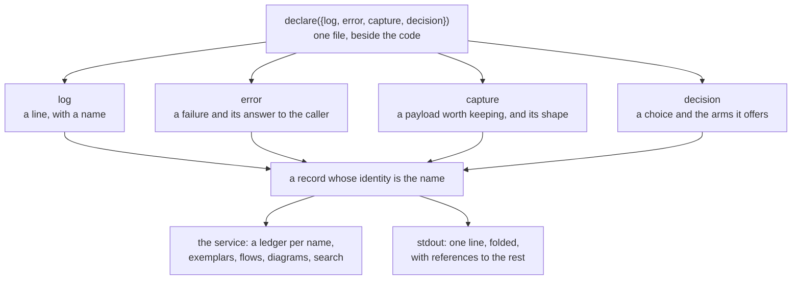

# lukaot — Rationale

## The problem

Every logging library in this repository's lineage solved the same problem a little further along,
and each solution left the next problem visible. It is worth walking the three steps, because
lukaot's shape is the answer to what the previous step could not do.

**A sentence on stdout** says what happened and nothing else. A person can read it; a program cannot
group it, count it, or silence one case without a text filter that breaks the next time somebody
edits a word.

**Structured logging** (pino, winston, and the level API the framework itself shipped first) added
fields and levels, which made records machine-readable. Three things it still could not do:

- **The call site composes the sentence.** A warn call whose message is a template literal puts the
  identity of an event in the same place as its data, so two spellings of one event are two rows and
  a reworded message is a new event.
- **A level is a dial for a whole service.** A noisy warning and the three errors beside it share
  one threshold; there is no way to raise, sample or silence _one_ case without editing the code.
- **A branch leaves no record.** `if (rate > limit)` is invisible afterwards: the outcome is in the
  log if somebody thought to log it, and the alternative that was weighed is nowhere.

**`core/semantic-log`** (this repository's previous package, now retired) attacked the first problem
with structure: mask the variable parts of a message, hash what is left, and two occurrences of one
code path share a **template** however their values differ. That survived a redeploy of unchanged
code, which was the point. It also made three other things real — a local reference per record, flow
and call identity carried across HTTP, and sequence diagrams drawn from records rather than from a
document.

What it could not fix is the part the hashing only moved: **identity was still derived from text**.
A reworded message really is a new template, so turnover was a feature of the design rather than an
accident, and the call site still chose the words. The level API was still the front door.

## The approach

**Declare the name; do not derive it.** An identifier is written once, in a `lukaot/` file beside
the code that reports it, and the call site reaches it as a function. The name is the record's
identity, so nothing has to be masked or hashed to make two occurrences of one path agree — they
already agree, because they call the same function.

That single change makes four things fall out, and each is one of the kinds:

**A name exists before a run**, which is what makes the rest possible: configuration can address one
case (`level`, `enabled`, `sample`), a reviewer can see a new event as a diff in a vocabulary file,
and a count is a count of one thing rather than of one spelling.

**The kind decides the shape, not the level.** An error is constructed and recorded when it is
created, and thrown where the caller throws it, so "what failed" and "what the caller answers" stop
being two statements. A capture is a payload with a shape and a rung, so its masking is a floor
rather than a caller's diligence. A decision records the discriminator, every arm in evaluation
order and the one taken, so a choice is evidence instead of an absence.

## What was kept, and what was dropped

Kept, because the previous design was right about them: local references per record, flow and call
identity carried across processes, withheld detail released on failure, one readable line with the
detail reachable on demand, the optional service, and diagrams generated from what a run observed.

Dropped, and not silently:

- **Template identity by hash.** Replaced by the declared name. Masking remains, but for payloads —
  a captured exchange and a redacted field — not to manufacture identity.
- **The level API as the front door.** `log.warn(…)` still exists for bootstrapping and for the
  compatibility logger, but a component with something to report declares it.
- **The three anomaly detectors** (novelty, rate-shift, drift) as separate scored alarms. What the
  service keeps is a count per name, first and last seen, exemplars and the flow ledger; a detector
  is a reader of that ledger rather than machinery inside the emitter.

## Trade-offs

**A declaration is a discipline.** Nothing forces a component to declare; `signal?.x?.()` on an
undeclared name is a type error, and the string forms that remain (a compatibility log call, a
decision named by a bare string) are escape hatches rather than the path. The cost is honest:
writing an event is now two edits, one in the vocabulary and one at the call site.

**A name is a release artefact.** Renaming an identifier is a new identity, exactly as rewording a
message was a new template. The difference is that it is now a visible diff in a file whose only job
is names, reviewed beside the code that uses it, instead of a string change buried in a call.

**A message belongs to its declaration.** A call cannot vary its sentence; it varies its values.
That is what makes the name stable, and it is also the constraint a person meets first — "I need a
different message here" is answered by a second declaration, not by a template literal.

**The vocabulary is per process, and composition is explicit.** A realm owns one array of
declarations shared by every layer's result, a port attaches what its layer declared, and a program
that hosts components of its own builds a view per component over one registry. Two declarations of
one name are refused with both origins named, because the likely cause is one signal declared on two
paths.

**Nothing here is a log store or a tracing backend.** Retention exists so that a reference resolves
and an occurrence can be inspected; the service keeps counts and evidence for a while, not a corpus.
That was true before and it is still true, and saying it is what keeps the design from growing a
second, accidental contract.

- What it is: [concept](../concepts/lukaot.md)
- How to use it: [pattern guide](../patterns/lukaot.md)
- A run drawn leg by leg: [flow walkthrough](../patterns/lukaot-flows.md)
