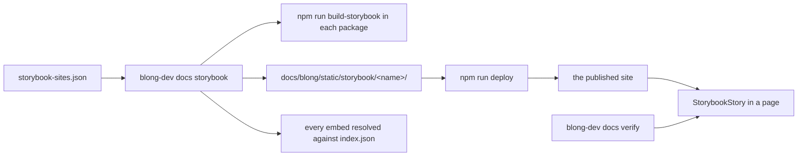

# Publishing the Storybooks with the documentation

## Goal

Two things at once: the Storybooks of the packages these docs describe are **published with the
docs**, and a page can **embed a specific story live** — in a docs page and in a blog post alike —
where a picture cannot settle what a paragraph is claiming.

The draft this plan grew out of proposed the iframe shape that survived, and three things it did not
have. It assumed a Storybook hosted somewhere else (a second domain, a second deploy to forget); it
had no fallback for a page whose Storybook is not reachable; and it had nothing that notices a story
id which no longer exists — the failure a reader experiences as an empty frame and nobody else ever
sees @@D-556 @@D-557. All three are what the design below is mostly about. The links it ended with
are still the right references for the platform behaviour:
[Docusaurus embeds](https://docusaurus.io/tests/pages/embeds) and
[Storybook sharing](https://storybook.js.org/docs/sharing/embed).

## What was built



### The register

`docs/blong/storybook-sites.json` names each site, the package that builds it, the build command and
the directory it writes. Three sites today: `browser` (`core/blong-browser`), `suite`
(`suite/blong-suite`) and `log` (`tools/blong-log`). Adding one is an entry plus a `site` attribute.

**Two sites rather than one composed build** is the decision that shaped the rest. A Storybook has
exactly one preview file, and the two previews are the two kinds of story: `blong-browser`'s own
preview renders component stories from in-file `withDispatch` fixtures with no platform at all, and
a realm's preview loads the platform with the mock adapter. Composing them into one build would
render one of the two kinds against the wrong fixtures — so the split follows the previews the
packages already have, and a page names the site it reads from.

### Staging

`blong-dev docs storybook [--only <name>] [--no-build] [--dry-run]` builds each site in its own
package and copies the output to `docs/blong/static/storybook/<name>/`, which Docusaurus serves
verbatim at `/storybook/<name>/` in `npm start`, `npm run build`, `npm run serve` and
`npm run deploy`. Publishing into the docs site rather than hosting the Storybook elsewhere is what
makes an embed **same-origin**: no cross-site frame policy, no second certificate, no second deploy.

The staged trees are 10 to 30 MB each and are deliberately **not committed**
(`docs/blong/.gitignore`). They are build outputs of other packages, and the docs package installs
its own `node_modules` with npm so that no monorepo build stands between a docs change and a
`docusaurus build`. Staging is therefore a step of the **deploy** (`docs/blong`'s `deploy` script
runs it; `deploy-docs-only` skips it) rather than of the build: in CI, where nothing is staged,
every embed renders its poster and the verification run counts the embeds that rendered.

### The embed

`<StorybookStory site="…" id="…" />`, registered for every MDX page by
`docs/blong/src/theme/MDXComponents.jsx`, so no page imports it. Attributes: `title`, `height`,
`globals`, `chrome`, `poster`. The rendered markup is a `<figure>` carrying
`data-storybook-site`/`data-storybook-id`, which is what the verification run counts.

- **`poster` → click to load.** The picture a page already has is shown first and the story opens on
  a click. This is the honest default: a reader is not made to wait for a Storybook frame to decide
  whether they want it, and a build with no Storybook staged still shows a picture rather than an
  empty box. A poster is written as `poster={require('./img/page.png').default}`, not as a path:
  Docusaurus copies an image into the build only when something imports it, so a plain relative
  `src` in JSX 404s — the first `docs verify` run after the embeds were written reported exactly
  that, which is how the shape was found.
- **`globals` is a Storybook URL's globals.** `theme:wood`, `language:bg`, `direction:rtl` — the
  same mechanism the toolbar writes, so a page about a variant embeds the variant.
- **`chrome` embeds the manager** instead of the canvas, which is the only way to show the story
  toolbar: it is Storybook's own UI, outside the story canvas.

### The checks

Both live where they can fail a publish rather than be discovered by a reader.

- **Staging resolves every embed** against the `index.json` the build itself wrote: an unknown site,
  a missing attribute or an id the site does not serve fails the run. Quoted examples in a fence are
  skipped, the way an `@@` reference inside backticks is, so the page that documents the tag can
  show it.
- **`blong-dev docs verify` loads each embedded story** when its site is staged: a fresh tab at the
  canvas URL, waiting for `#storybook-root` to have children. That is exactly the signal — Storybook
  renders its "No Preview" notice _outside_ the root, so the failing case leaves it empty. It is the
  only check that catches a preview which cannot boot without a dev server, and the count of embeds
  per page (`<StorybookStory>` tags in the markdown against `[data-storybook-id]` elements in the
  rendered page) is what catches a tag the MDX parser dropped.

### Where embeds were placed

| Page                                          | Story                                        | Why there                                          |
| --------------------------------------------- | -------------------------------------------- | -------------------------------------------------- |
| `patterns/blong-browser.md#embedding-a-story` | `editor--toolbar`                            | the how-to, showing the tag it documents           |
| `concepts/editor-features.md` (§2, §7, §9)    | toolbar, design mode, cascaded dropdowns     | the sections about behaviour a picture cannot show |
| `concepts/blong-model.md`                     | `marine-coral--browse`                       | the generated page, live                           |
| `patterns/blong-model.md`                     | `marine-coral--new`                          | the page type the pictures do not show             |
| `concepts/browser-ui.md#storybook`            | `marine-portal--marine`                      | the portal shell the page describes                |
| `patterns/i18n.md`                            | `editor--toolbar` at `globals="language:bg"` | a language variant, not prose about one            |
| `patterns/theme.md#reviewing-a-variant`       | `editor--glass` and `editor--wood`           | the pair the section says to compare               |
| `blog/2026-10-15-the-storybook-in-the-page/`  | toolbar, then `editor--wood`                 | the post that announces the capability             |

## Trade-offs and things not built

- **Fixtures only.** The toolbar's live-backend modes are a Storybook **dev-server** plugin, and a
  static build has no dev server, so an embedded story is always the fixture-backed page. That is
  the right thing for documentation; reviewing against a real gateway stays a local act.
- **The published Storybooks are built non-minified**, about 46% larger (the suite site: 26 MB → 38
  MB). That is not a preference: a realm child is an `async function ui() {…}` and the loader finds
  the child's config block by the function's own name, so a minified build silently serves a
  platform with no `ui` realm and every model page story dies before it renders @@F-537.
  `output.keepNames` changed nothing on this Vite, so not minifying — which is what the app build
  does — is the fix; the fragility itself is recorded as @@T-350.
- **No hosted Storybook service.** Chromatic already covers visual baselines in CI; this publishes
  for a reader, on the docs' own origin, with no account and no per-build URL to keep.
- **`docusaurus serve` cannot serve an embed, so the package does not use it.** It rewrites
  `/storybook/<name>/` to `/storybook/<name>` and `iframe.html?id=…` to `iframe`, which resolves a
  published Storybook's relative bundles one directory too high and hands the preview no story id.
  `docs/blong`'s `npm run serve` is now `blong-dev docs serve` (the same minimal static server
  `docs verify` loads, but on a named port) and `npm run serve:docusaurus` keeps the Docusaurus one
  @@F-534 @@D-559.
- **Deferred:** a `patterns/log.md` embed of the log viewer (the `log` site is registered and
  staged, and nothing embeds it yet) @@T-347; a Storybook preview published per pull request
  @@T-349. The skill's own two-h1 lint failure is recorded as @@T-348.

## Verification

```bash
blong-dev docs storybook --only browser        # build, stage, resolve every embed
cd docs/blong && npm run build                 # the site builds with the staged tree in place
blong-dev docs verify --filter 'patterns/blong-browser.md'
cd tools/blong-dev && node --run test          # the register, staging and embed checks
```

An embedded story was confirmed to render from the staged build in a browser (`#storybook-root`
holding the toolbar story's content), and `docs verify` was extended so that a run does it for every
embed on every page.
